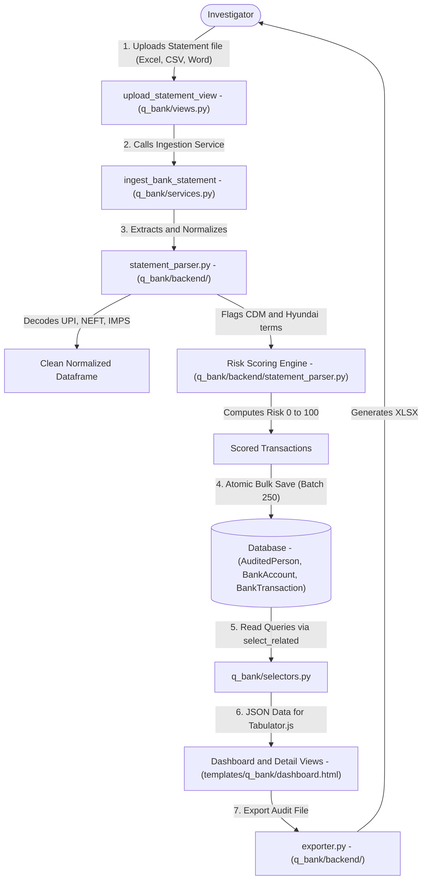
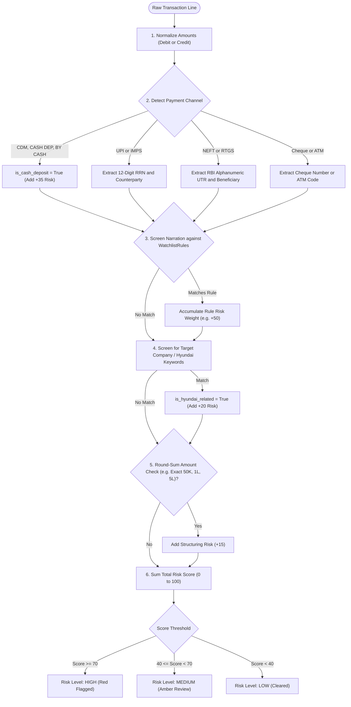

# Q-Bank — Data & Architecture Flow

> **Audience**: Anyone seeking a clear, layman-friendly explanation of how Q-Bank ingests, analyzes, flags, and presents bank statements — grounded in the actual Python codebase.

---

## 1. The Big Picture: What is `q_bank`?

Imagine you are handed **thousands of pages of bank statements** from different banks (HDFC, ICICI, SBI) in PDF, Excel, CSV, or Word format. Looking at hundreds of cryptic lines like:
`UPI/412345678901/PAYMENT TO SHARMA ENTERPRISES/HDFC/0012`
by hand would take weeks, and you might miss critical red flags.

**Q-Bank is an automated forensic financial accountant**. It:
1. **Reads Bank Files**: Ingests Excel, CSV, or Word tables of bank statements.
2. **Decodes Banking Jargon**: Extracts who sent the money, who received it, the bank method used (UPI, NEFT, IMPS, RTGS, ATM, Cheque), and the exact reference number (UTR).
3. **Spots Cash Laundering**: Flags Cash Deposit Machine (CDM) transactions where untraceable cash was slipped into the account.
4. **Calculates Suspicion Scores**: Checks every transaction against watchlists, company-related entities (like Hyundai), and unusual amounts, assigning each transaction a Risk Score from 0 to 100.
5. **Generates Interactive Dashboards & Excel Sheets**: Lets the investigator filter, search with fuzzy spelling matching, and export clean audit reports.

---

## 2. Architecture & File Breakdown

The `q_bank` codebase follows ForensiQ's strict 4-Tier Architecture:

```
apps/q_bank/
├── models.py                     # Database schemas: AuditedPerson, BankAccount, BankTransaction, WatchlistRule
├── selectors.py                  # Read-only queries (fast aggregation, zero N+1 database queries)
├── services.py                   # Business actions: Orchestrates file parsing and database saving inside atomic transactions
├── views.py                      # HTTP Controllers: Dashboard, Account Detail, Ingestion Upload, API endpoints
├── urls.py                       # Route mapping: URLs connecting browser actions to view functions
├── templates/q_bank/             # Cotton & HTML UI templates: dashboard.html, person_detail.html, account_detail.html
└── backend/                      # Pure computation & parsing (independent of Django request cycles)
    ├── statement_parser.py       # Extraction engine: Normalizes tabular data, decodes narrations, calculates risk
    └── exporter.py               # Report generator: Assembles styled Excel workbooks (.xlsx) using openpyxl
```

---

## 3. End-to-End Data Flow

Here is the step-by-step journey of a bank statement through Q-Bank:



### Detailed Flow Steps:

1. **Upload & Auditee Mapping (`views.py` -> `services.py`)**:
   - The investigator navigates to the Q-Bank dashboard and opens the statement import modal.
   - They choose or enter the **Audited Person** (linked to `core.InvestigationProfile`), the bank name, and select the file (`.xlsx`, `.xls`, `.csv`, `.docx`).
   - The request hits `upload_statement_view()`, which passes the file stream to `services.ingest_bank_statement()`.

2. **Parsing & Cleaning (`backend/statement_parser.py`)**:
   - If the file is a Word document, `extract_tables_from_word()` pulls out tabular cells. If Excel or CSV, Pandas loads the sheet.
   - `normalize_dataframe()` identifies which column is the Transaction Date, Value Date, Narration, Debit, Credit, and Balance, handling irregular bank column names.
   - Commas, currency symbols (₹, $), and negative signs are stripped into clean Python `Decimal` numbers.

3. **Forensic Narration Decoding & Entity Extraction**:
   - Bank narrations are usually tangled strings. The parser uses regular expressions to isolate:
     - **UTR / Reference IDs**: 12-digit UPI numbers or alphanumeric NEFT/RTGS codes.
     - **Payment Channels**: Distinguishes whether the transfer was UPI, IMPS, NEFT, RTGS, POS card swipe, ATM cash withdrawal, or CDM deposit.
     - **Counterparty Name**: Pulls out the name of the person or vendor on the other side of the transaction.

4. **Risk Scoring & Watchlist Screening**:
   - **Cash Deposit Detection**: If narration matches Cash Deposit Machines (e.g. `CDM`, `CASH DEP`, `BY CASH`), `is_cash_deposit` is set to `True`.
   - **Entity Matching**: Checks if any party name matches known target auditees or company keywords (e.g., Hyundai).
   - **Risk Score Calculation**: Evaluates the transaction against active `WatchlistRule`s. High-value round-sum amounts, repetitive cash deposits, or matches with flagged vendors push the `risk_score` towards 100 (`HIGH` risk).

5. **Atomic Database Insertion (`services.py` & `models.py`)**:
   - Inside a `@transaction.atomic` block:
     - A `BankAccount` record is created or updated with aggregate statistics (total debit, total credit, cash deposit count, high-risk count).
     - Individual transactions are converted to `BankTransaction` objects and inserted in batches of 250 using Django's `bulk_create()`.

6. **Interactive Presentation & Export (`selectors.py` & `exporter.py`)**:
   - The frontend renders using **Django Cotton components** and **Tabulator.js** for high-speed client-side filtering, sorting, and pagination.
   - Investigators can perform fuzzy keyword searches across thousands of narrations simultaneously.
   - With one click, `export_ledger_excel_view()` invokes `backend/exporter.py` to produce a formatted forensic Excel workbook containing color-coded risk flags.

---

## 4. Business Logic Flow & Decision Rules

The business logic in `q_bank` evaluates every single line item to determine whether money represents legitimate corporate business or suspicious money laundering.



### Detailed Business Rules & Logic Specifications:

| Rule Name | Trigger Condition | Logic & Thresholds | Outcome / Business Action |
| :--- | :--- | :--- | :--- |
| **Cash Deposit Machine (CDM) Detection** | Narration contains `CDM`, `CASH DEP`, `BY CASH`, `SELF`, `CDM-CASH` | Scans narration with regex `(?i)\b(cdm|cash\s*dep|by\s*cash|cash\s*deposit)\b`. Sets `is_cash_deposit = True`. | Adds +35 to transaction risk score. Increments account `cash_deposit_count`. Untraceable cash deposits are primary bribery indicators. |
| **UTR & Channel Extraction** | Transaction processed via Indian payment gateways | Regex extraction: 12-digit UPI/IMPS RRN (`(?<!\d)\d{12}(?!\d)`) or alphanumeric NEFT/RTGS code. | Isolates transaction reference to enable multi-bank reconciliation in `q_trail`. |
| **Counterparty Name Extraction** | UPI/NEFT narration with delimiter markers | Strips noise tokens (`BIL/`, `TRANSFER`, `UPI-`, `NEFT-`, `INB`, `/XX`). Isolates recipient string. | Populates `party_name` for cross-matching against vendors in `q_ledger` and suspects in `q_link`. |
| **Dynamic Watchlist Scoring** | Narration or counterparty matches active `WatchlistRule` | Exact or substring match against custom keywords (e.g. `KICKBACK`, `CONSULTANCY`, `COMMISSION`, `PERSONAL`). | Increments `risk_score` by the rule's defined `risk_weight` (typically +30 to +50 points). |
| **Round-Sum Structuring Flag** | Cash or transfer amount matches round intervals | Check: `amount >= 50,000` and `amount % 10,000 == 0`. | Adds +15 risk points. Flags potential smurfing (breaking bribes into neat round amounts). |
| **Risk Tier Classification** | Sum of all risk points computed | Calculated risk score clamped to range `[0, 100]`. Tiers: `>= 70` = `HIGH`, `40 - 69` = `MEDIUM`, `< 40` = `LOW`. | `HIGH` risk items appear in top red alert tables and export summaries. |
| **Account Risk Escalation** | Total high-risk transactions in an account > 5 | Aggregation query computes `high_risk_count`. If `high_risk_count >= 5`, sets account `status = FLAGGED`. | Escalates the entire bank account to senior audit review. |

---

## 5. Key Database Entities in `q_bank`

| Model Name | What it Stores | Why it Matters to the Investigator |
| :--- | :--- | :--- |
| `AuditedPerson` | Full name, employee ID, department, PAN, contact info | The human subject being audited. Can have multiple accounts across different banks. |
| `BankAccount` | Bank name, account number, total debits, total credits, risk counters | The financial account container summarizing overall fund velocity and risk counts. |
| `BankTransaction` | Txn date, narration, counterparty name, debit, credit, balance, UTR, risk score | The atomic transaction record with automated forensic flags (`is_cash_deposit`, `is_hyundai_related`). |
| `WatchlistRule` | Keyword, risk weight, category (e.g., "KICKBACK" -> +50 risk) | Dynamic audit rules enabling auditors to flag suspicious narrations automatically. |

---

## 6. How `q_bank` Connects to Other Apps

- **To `core`**: Links each audited person to the central `core.InvestigationProfile` and groups investigations under the active `core.Audit` mandate.
- **To `q_trail`**: Q-Bank transactions serve as the **fuel** for Q-Trail. Q-Trail stitches multiple Q-Bank accounts together to map multi-hop money laundering routes (Person A -> Person B -> Person C).
- **To `q_link`**: Counterparties extracted from bank narrations are sent to `q_link` to check if a bank counterparty also appears as an email contact in `q_mail` or a vendor in `q_ledger`.
