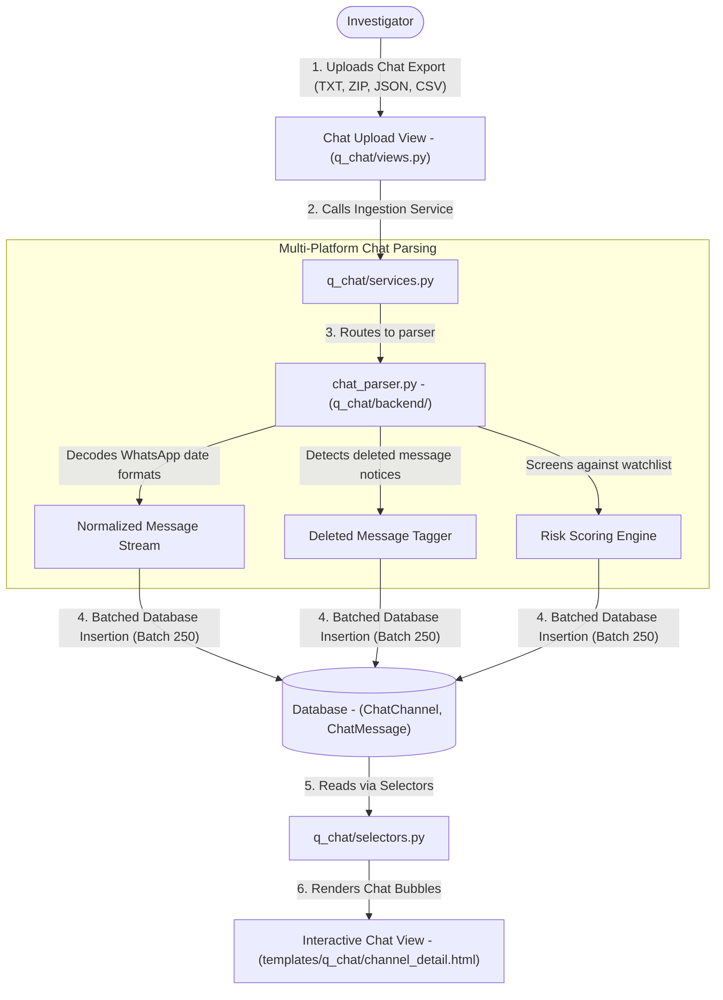
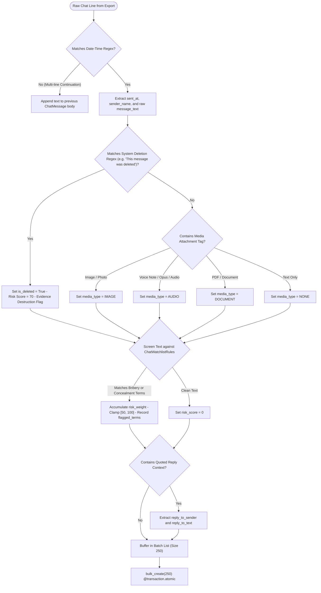

# Q-Chat — Data & Architecture Flow

> **Audience**: Anyone seeking a clear, layman-friendly explanation of how Q-Chat parses instant messaging exports, reconstructs chat threads, flags deleted messages, and screens for bribery and collusion — grounded in the actual Python codebase.

---

## 1. The Big Picture: What is `q_chat`?

In today's corporate world, illicit deals are rarely made over official company email. Corrupt employees move discussions to **instant messaging platforms**:
- **WhatsApp**: The #1 tool for negotiating informal side deals, kickbacks, and cash handoffs.
- **Microsoft Teams & Slack**: Used for real-time internal coordination and sharing sensitive file links.
- **Telegram & Signal**: Used when suspects deliberately seek disappearing messages and end-to-end encryption.

When a suspect's phone or desktop is backed up, forensic investigators export these chat histories into raw text files (`.txt`), zip archives, or JSON/CSV dumps.

A single chat export can contain **tens of thousands of messages** filled with emojis, timestamps, media attachment placeholders, and deleted message notices.

**Q-Chat is an automated chat forensic reconstruction and screening engine**. It:
1. **Parses Multi-Platform Chat Exports**: Reads WhatsApp (`.txt` and `.zip`), Microsoft Teams / Slack (`.json` and `.csv`), and Telegram exports.
2. **Rebuilds Conversation Timelines**: Reconstructs threads in chronological order, showing who spoke to whom, reply quotes, and media attachments.
3. **Detects Tampering & Deletions**: Flags messages that were retracted or deleted by the sender (*"This message was deleted"*).
4. **Screens for Collusion & Bribery**: Automatically scans message text for off-the-record codewords, cash references, and kickback requests.
5. **Extracts Digital Identifiers & Entities**: Discovers phone numbers, UPI VPAs, and company names exchanged within chat bubbles using `core.entity_extractor`.

---

## 2. Architecture & File Breakdown

The `q_chat` codebase is designed for multi-format conversational parsing and high-speed chat rendering:

```
apps/q_chat/
├── models.py                   # Schemas: ChatChannel, ChatMessage, ChatWatchlistRule
├── selectors.py                # Read queries: Fast channel listings, thread pagination, risk filters
├── services.py                 # Business workflow: Orchestrates chat parsing and atomic batch insertion
├── views.py                    # Controllers: Chat dashboard, channel detail timeline, custodian directory
├── urls.py                     # Route mapping: Endpoints for chat uploads and message search
├── templates/q_chat/           # UI templates: dashboard.html, channel_detail.html (WhatsApp-style chat UI)
└── backend/                    # Parsing and forensic screening backend
    └── chat_parser.py          # Multi-platform parser (WhatsApp regexes, Teams/Slack JSON, Telegram), risk scorer
```

---

## 3. End-to-End Data Flow

Here is how instant message evidence moves through Q-Chat:



### Detailed Flow Steps:

1. **Upload & Platform Identification (`views.py` -> `services.py`)**:
   - The investigator uploads a chat export file, specifies the platform (`WHATSAPP`, `TEAMS`, `SLACK`, `TELEGRAM`, or `SMS`), and assigns the custodian from `core.InvestigationProfile`.

2. **Regex Parsing & Timestamp Normalization (`backend/chat_parser.py`)**:
   - Different phone models write timestamps differently (e.g. `12/03/24, 10:15 pm - `, `[12/03/2024, 22:15:00]`, `2024-03-12T22:15:00Z`).
   - `chat_parser.py` uses multi-pattern regular expressions (`WHATSAPP_PATTERNS`) to reliably parse dates, sender names, and message text across Indian and international phone regional formats.

3. **Deleted Message & Media Detection**:
   - System events like *"This message was deleted"* or *"You deleted this message"* are flagged with `is_deleted = True`. In forensic investigations, deleted messages often indicate panic or consciousness of guilt!
   - Attached photos, audio voice notes, and documents are extracted and linked with their `media_type`.

4. **Forensic Screening & Risk Scoring (`screen_message_text`)**:
   - Every message is checked against active `ChatWatchlistRule`s:
     - **Bribery & Kickbacks**: *cash, token, cut, commission, favor, account transfer*.
     - **Concealment**: *delete this, call me on Signal, secret, don't tell anyone*.
   - Messages containing these terms receive an elevated `risk_score` (up to 100) and have their matching terms highlighted.

5. **Atomic Batch Insertion (`services.py` & `models.py`)**:
   - Extracted messages are saved in **batches of 250** via `bulk_create()` wrapped in `@transaction.atomic`.
   - The parent `ChatChannel` is updated with aggregate metrics: total messages, flagged messages count, date range, and overall channel risk score.

6. **WhatsApp-Style Interactive Chat Viewer (`templates/q_chat/channel_detail.html`)**:
   - The frontend renders an authentic **chat bubble view** with sender names, timestamps, delivery checkmarks, and color-coded risk badges.
   - Auditors can jump to specific flagged dates or search text across tens of thousands of messages instantly.

---

## 4. Business Logic Flow & Decision Rules

Q-Chat parses unstructured conversational dialogue and applies forensic rules to detect tampering, evidence destruction, and illicit coordination.



### Detailed Business Rules & Logic Specifications:

| Rule Name | Trigger Condition | Logic & Thresholds | Outcome / Business Action |
| :--- | :--- | :--- | :--- |
| **Multi-line Message Continuation** | Line does not start with date regex pattern | If regex match fails, line is treated as an intentional line break of the previous sender's message. | Preserves long multi-paragraph confessions, contract drafts, and financial quotes intact. |
| **Deleted Message Evidence Flag** | Line matches `WHATSAPP_SYSTEM_REGEXES` | Matches *This message was deleted* or *You deleted this message*. Sets `is_deleted = True`. | Assigns `risk_score = 70`. Alerts auditors to suspicious communication redactions. |
| **Media Type Categorization** | Line contains media placeholder tokens | Detects file extensions (`.jpg`, `.opus`, `.pdf`, `.mp4`) or text `<attached: ...>`. Assigns `media_type`. | Isolates voice notes and photos for physical inspection. |
| **Chat Codeword Screening** | Message text matches active `ChatWatchlistRule` | Evaluates against collusion keywords (*token, cut, advance, don't message here, signal, cash*). | Computes `risk_score = max(50, min(100, total_weight))` and records `flagged_terms`. |
| **Quoted Reply Context Reconstruction** | User replied to a previous message | Extracts quoted snippet into `reply_to_sender` and `reply_to_text`. | Preserves context when a suspect answers *"Yes, agreed"* to an illegal proposal. |
| **Channel Risk Aggregation** | Batch insertion completed | Computes `flagged_messages_count`. If `flagged_messages_count > 0`, sets channel risk = `max(message_risk)`. | Renders priority red badge on the channel directory. |

---

## 5. Key Database Entities in `q_chat`

| Model Name | What it Stores | Why it Matters to the Investigator |
| :--- | :--- | :--- |
| `ChatChannel` | Platform, channel name, custodian, total messages, flagged count, risk score | The conversation thread or group chat container. |
| `ChatMessage` | Channel, sender name, sent date, text, media type, deleted flag, risk score, flagged terms | The atomic instant message bubble with forensic risk tags. |
| `ChatWatchlistRule` | Keyword, risk weight, category (`Collusion`, `Bribery`) | Custom screening rules used to detect illicit discussions in chat logs. |

---

## 6. How `q_chat` Connects to Other Apps

- **To `core`**: Custodians link to `core.InvestigationProfile`, and chat investigations belong to the active `core.Audit`.
- **To `q_link`**: Chat participants, phone numbers, and mentioned counterparties are fed into `q_link` to create communication links in the knowledge graph.
- **To `q_bank`**: If a suspect texts an account number or payment confirmation in WhatsApp, Q-Bank can immediately trace the corresponding financial transaction.
