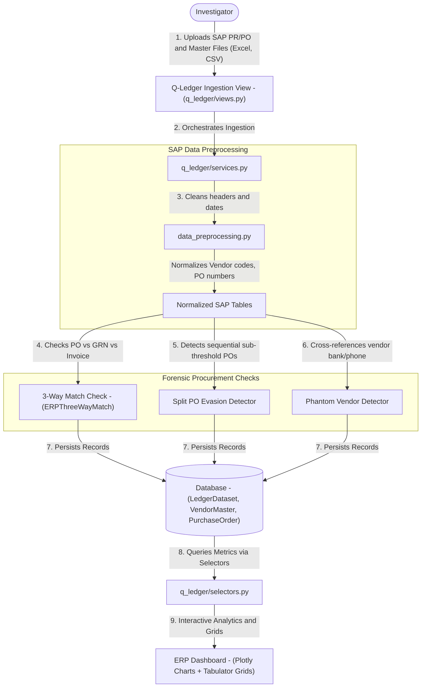
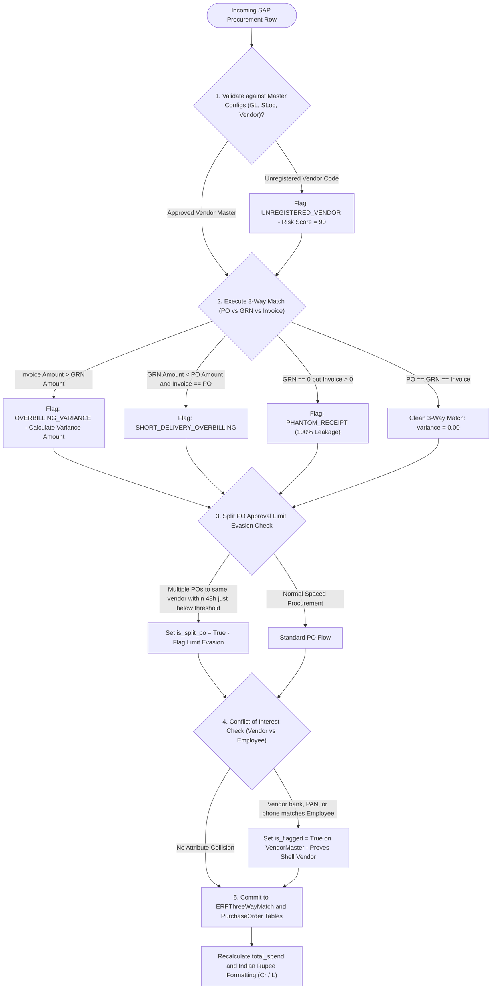

# Q-Ledger — Data & Architecture Flow

> **Audience**: Anyone seeking a clear, layman-friendly explanation of how Q-Ledger audits SAP ERP procurement data, detects phantom vendors, catches split Purchase Orders, and performs 3-way matching — grounded in the actual Python codebase.

---

## 1. The Big Picture: What is `q_ledger`?

In large corporations, procurement departments spend **hundreds of crores of rupees** buying parts, raw materials, and services through ERP systems like SAP.

Because the volume of procurement is so vast, dishonest employees exploit procedural loopholes to siphon corporate funds:
1. **The "Split Purchase Order" Trick**: If company policy requires Vice President approval for any Purchase Order (PO) above ₹5,00,000, a corrupt manager might issue **two separate POs for ₹4,80,000 on the same day** to bypass senior approval and favor a friendly vendor.
2. **Phantom Vendors**: Creating a fake company in the SAP Vendor Master that has no real warehouse, no real employees, and shares a bank account or phone number with a company employee.
3. **The 3-Way Matching Fraud**: Normally, payment is only made if three documents agree:
   - The **Purchase Order (PO)**: What was ordered.
   - The **Goods Receipt Note (GRN)**: What was physically delivered at the warehouse.
   - The **Vendor Invoice**: What the vendor billed.
   Corrupt actors bill the company for 1,000 parts when only 600 were physically delivered to the factory floor!

**Q-Ledger is an automated SAP procurement audit engine**. It ingests SAP PR/PO dumps, Material Masters (MARA), Storage Locations (SLoc), and General Ledgers (GL), checks them against forensic rules, and instantly flags procurement fraud.

---

## 2. Architecture & File Breakdown

The `q_ledger` codebase is organized around enterprise ERP data pipelines and forensic rule engines:

```
apps/q_ledger/
├── models.py                     # Schemas: LedgerMasterConfig, LedgerDataset, VendorMaster, PurchaseOrder, ERPThreeWayMatch
├── selectors.py                  # Read queries: Fast spend analytics, vendor risk ranking, anomaly summaries
├── services.py                   # Ingestion: Uploads SAP master tables, runs batch anomaly detectors
├── views.py                      # Controllers: ERP dashboard, procurement data grid, anomaly filters
├── urls.py                       # Route mapping: Endpoints for SAP datasets and anomaly views
├── templates/q_ledger/           # UI templates: dashboard.html, includes/table_view.html (Tabulator grids & Plotly charts)
└── backend/                      # Specialized SAP data processing engines
    ├── data_preprocessing.py     # Cleans SAP columns, handles dates, normalizes vendor IDs and material codes
    └── analysis_functions.py     # Computes 3-way match variances, split PO flags, and Plotly spend charts
```

---

## 3. End-to-End Data Flow

Here is how SAP ERP records are ingested and screened for procurement fraud:



### Detailed Flow Steps:

1. **Master Configuration & File Ingestion (`services.py` & `models.py`)**:
   - The investigator uploads standard SAP extraction sheets:
     - **PR/PO File**: Purchase Requisition and Purchase Order transactions.
     - **MARA File**: Material Master dataset.
     - **Vendor Master File**: Vendor names, GSTINs, bank accounts, and addresses.
     - **SLoc & GL Masters**: Storage locations and general ledger account codes.
   - The files are permanently stored in `LedgerDataset` and `LedgerMasterConfig`.

2. **Data Preprocessing & Normalization (`backend/data_preprocessing.py`)**:
   - Cleans SAP column names, handles date formats (`Pstng Date`, `PO Date`), and converts currency numbers into standardized Python decimals.
   - Generates Indian currency formats (formatting amounts in Lakhs and Crores, e.g., ₹ 4.50 Cr).

3. **Core Forensic Anomaly Checkpoints (`backend/analysis_functions.py`)**:
   - **3-Way Match Reconciliation (`ERPThreeWayMatch`)**:
     - Compares the `PO Amount`, `GRN Amount` (physical goods received), and `Invoice Amount`.
     - Calculates the `variance_amount`. If the invoice amount exceeds the goods received, the transaction is flagged with an anomaly type.
   - **Split PO Approval Threshold Evasion**:
     - Identifies vendors receiving multiple POs on the same day or within 48 hours that fall just below executive approval thresholds.
   - **Phantom Vendor Screening**:
     - Screens `VendorMaster` records against employee profiles to find matching phone numbers, PAN cards, or bank account numbers.

4. **Interactive Dashboard & Plotly Visualizations (`selectors.py` & Cotton UI)**:
   - High-level executive charts display **Total Procurement Spend**, **Top 10 High-Risk Vendors**, and **Variance Distribution**.
   - An interactive **Tabulator.js** grid enables auditors to filter down to individual PO numbers, view the approved approver's name, and inspect line-item discrepancies.

---

## 4. Business Logic Flow & Decision Rules

Q-Ledger applies automated internal audit rules to detect procurement leakages and management limit evasions across SAP tables.



### Detailed Business Rules & Logic Specifications:

| Rule Name | Trigger Condition | Logic & Thresholds | Outcome / Business Action |
| :--- | :--- | :--- | :--- |
| **3-Way Match Overbilling Variance** | Vendor invoice amount exceeds goods physically received | Formula: `variance_amount = invoice_amount - grn_amount`. Condition: `variance_amount > 0`. | Flags `OVERBILLING_VARIANCE` anomaly. Proves company paid for goods never received in the warehouse. |
| **Short Delivery Overbilling** | Warehouse received partial goods, but full invoice paid | Condition: `grn_amount < po_amount` AND `invoice_amount == po_amount`. | Flags `SHORT_DELIVERY` anomaly. Prevents inventory shrinkage fraud. |
| **Phantom Delivery (Zero GRN)** | Invoiced and paid with zero goods received | Condition: `grn_amount == 0` AND `invoice_amount > 0`. | Flags `PHANTOM_RECEIPT` (100% fraudulent payout). Escalates directly to legal inquiry. |
| **Split PO Limit Evasion Rule** | Sequential POs issued just below executive threshold | Criteria: 1) Same vendor + same approver, 2) Time delta `<= 48 hours`, 3) Individual PO values `[0.80 * Limit, 0.99 * Limit]`, 4) Combined sum `> Limit`. | Sets `is_split_po = True`. Uncovers intentional evasion of senior executive authorization matrices. |
| **Phantom Vendor Entity Matching** | Vendor bank account, phone, or PAN matches employee | Cross-references `VendorMaster` fields against `core.InvestigationProfile` records. | Sets `is_flagged = True`. Identifies internal employees siphoning funds into shell companies they secretly own. |
| **Indian Rupee Formatting** | Currency presentation in dashboards and charts | Formats: `>= 1,00,00,000` -> `₹ X.XX Cr`, `>= 1,00,000` -> `₹ X.XX L`, else standard digit commas. | Displays human-readable executive financial figures instantly recognizable by management. |

---

## 5. Key Database Entities in `q_ledger`

| Model Name | What it Stores | Why it Matters to the Investigator |
| :--- | :--- | :--- |
| `LedgerMasterConfig` | GL accounts, storage locations, vendor masters files, total counts | Maintains reference baseline files for the active ERP audit. |
| `LedgerDataset` | Uploaded PR/PO and MARA files, total record count, total spend | The active procurement investigation dataset. |
| `VendorMaster` | Vendor code, vendor name, owner name, email, phone, GSTIN, bank details | Dossier of suppliers screened for phantom status or employee collusion. |
| `PurchaseOrder` | PO number, vendor, PO date, total amount, approver, split PO flag | The legal procurement commitment document issued by the company. |
| `ERPThreeWayMatch` | PO number, GRN number, invoice number, amounts, variance, anomaly type | The forensic comparison record proving overbilling or phantom delivery. |

---

## 6. How `q_ledger` Connects to Other Apps

- **To `core`**: Vendors and approvers link to `core.InvestigationProfile`, and datasets belong to the active `core.Audit`.
- **To `q_link`**: Vendor codes, PO numbers, and approver names are fed to `q_link`. If an employee approved POs for a vendor who transferred money to that employee's spouse in `q_bank`, `q_link` triggers a **Vendor Kickback Alert**!
- **To `q_verify`**: Questioned vendor invoices can be passed to `q_verify` to check for Canva or Photoshop metadata alterations.
