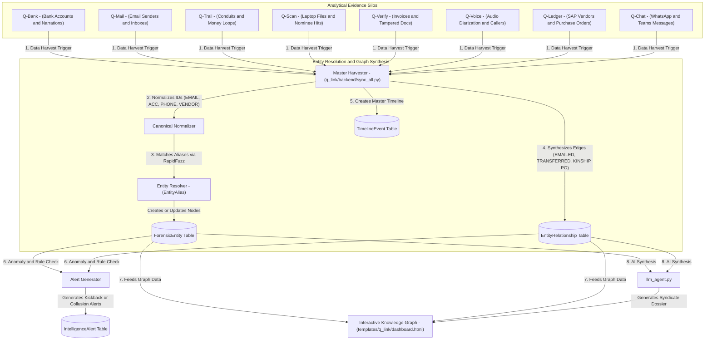
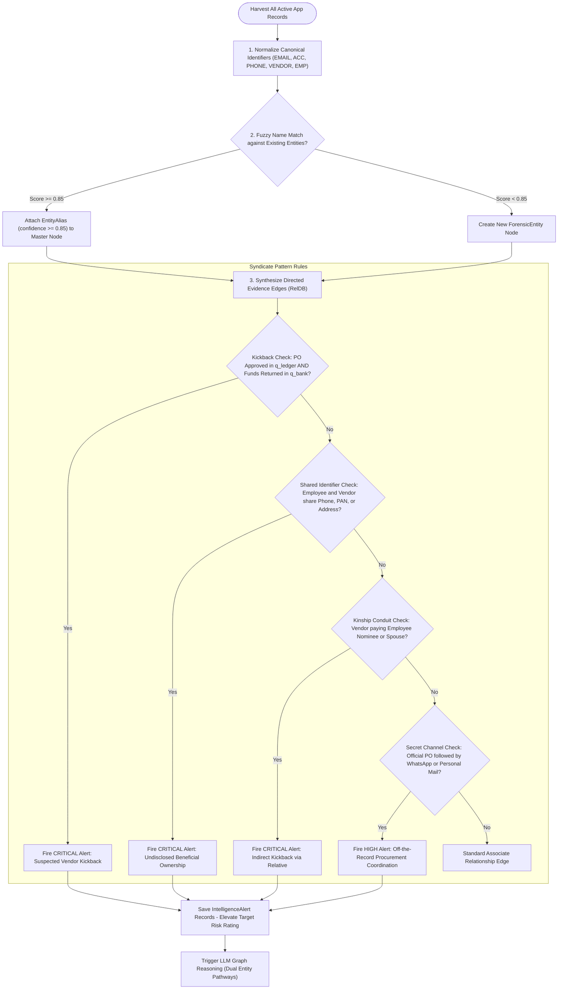

# Q-Link — Data & Architecture Flow

> **Audience**: Anyone seeking a clear, layman-friendly explanation of how Q-Link acts as the master forensic "brain" of ForensiQ, connecting the dots across emails, bank transactions, chats, and SAP ledgers — grounded in the actual Python codebase.

---

## 1. The Big Picture: What is `q_link`?

In a complex fraud investigation, **evidence is scattered across different silos**:
- In **`q_bank`**, an employee receives money from an unknown person named "S. Sharma".
- In **`q_mail`**, the same employee receives an email with an invoice from `sharma.trading@gmail.com`.
- In **`q_scan`**, a seized laptop contains an Excel file listing "Sunil Sharma" as the nominee of a vendor.
- In **`q_ledger`**, SAP records show that purchase orders were approved for "Sharma Logistics" without tenders.
- In **`q_chat`**, a WhatsApp message says: *"Sharma ji, send it to the same account"*.

No single department or tool has the full picture. If you look at `q_bank` alone, it just looks like a normal bank transfer.

**Q-Link is the master intelligence graph and syndicate detector**. It:
1. **Aggregates Evidence from All 8 Modules**: Automatically harvests entities from bank statements, emails, audio wiretaps, chats, disk scans, and SAP ledgers.
2. **Performs Entity Resolution & De-duplication**: Realizes that "S. Sharma", "Sunil Sharma", "sharma.trading@gmail.com", and "Sharma Logistics" are all the **same person or group** using fuzzy string matching and canonical identifiers.
3. **Builds a Master Knowledge Graph**: Maps out who is connected to whom, how much money moved between them, and what emails or chats connect them.
4. **Fires Automated Fraud Syndicate Alerts**: Automatically flags high-level fraud patterns (e.g., *Vendor Kickback Detected*, *Shared Phone/Address*, *Hidden Family Member Beneficiary*).
5. **AI Syndicate Dossier Writer (`llm_agent.py`)**: Uses specialized AI prompts to summarize an entire fraud syndicate's network in clear executive English.

---

## 2. Architecture & File Breakdown

The `q_link` codebase acts as the central convergence point for the whole platform:

```
apps/q_link/
├── models.py                 # Schemas: ForensicEntity, EntityAlias, EntityRelationship, EvidencePointer, TimelineEvent, IntelligenceAlert
├── selectors.py              # Read queries: Network graph topology, entity profiles, alert feeds, chronological timelines
├── services.py               # Orchestration: Triggers full-system sync, creates manual links, resolves conflicts
├── views.py                  # Controllers: Master graph dashboard, entity dossier explorer, AI synthesis endpoints
├── urls.py                   # Route mapping: Endpoints for knowledge graph visualization and intelligence alerts
├── templates/q_link/         # UI templates: dashboard.html with interactive Vis.js graph canvas
├── prompts/                  # AI Prompts: syndicate_overview.txt, dual_entity_pathways.txt, single_entity_dossier.txt
└── backend/                  # Intelligence & Synchronization engines
    ├── sync_all.py           # Master harvester: Pulls and normalizes entities from all 8 forensic modules
    ├── dispatcher.py         # Real-time event broker: Updates graph when any individual app finishes ingesting files
    └── llm_agent.py          # AI Knowledge Graph Analyst: Explains hidden pathways between any two suspects
```

---

## 3. End-to-End Data Flow

Here is how isolated evidence points become an interconnected fraud graph:



### Detailed Flow Steps:

1. **Master Synchronization (`backend/sync_all.py`)**:
   - The investigator clicks "Sync Intelligence" on the Q-Link dashboard, or an individual app triggers a background sync via `dispatcher.py`.
   - `sync_all.py` queries every app database table across the system.

2. **Canonical Normalization & De-duplication**:
   - Entities are transformed into standard canonical keys:
     - Emails: `EMAIL:sharma@vendor.com`
     - Bank Accounts: `ACC:HDFC:1234567890`
     - Phone Numbers: `PHONE:+919876543210`
     - Vendors: `VENDOR:V10023`
     - Employees: `EMP:HYU-9021`
   - If an entity appears under slight spelling variations (e.g., "S. Sharma" vs "Sunil Sharma"), `EntityAlias` uses `core.fuzzy` (RapidFuzz) to link the alias to the master `ForensicEntity`.

3. **Relationship Edge Creation (`models.EntityRelationship`)**:
   - The engine generates directed connections between entities:
     - `TRANSFERRED_FUNDS` (sourced from `q_bank` and `q_trail`)
     - `EMAILED` (sourced from `q_mail`)
     - `ISSUED_PO` / `APPROVED_BY` (sourced from `q_ledger`)
     - `KINSHIP` / `SPOUSE` / `NOMINEE` (sourced from `q_scan` and `core.entity_extractor`)
     - `COMMUNICATED_ON_CHAT` (sourced from `q_chat`)

4. **Automated Intelligence Alerts (`models.IntelligenceAlert`)**:
   - Q-Link analyzes the assembled graph topology looking for fraud signatures:
     - **Vendor Kickback Alert**: If an employee approved an SAP Purchase Order for Vendor V, and that same vendor (or the vendor's spouse) sent money to the employee's bank account.
     - **Shared Digital Identifier**: If a vendor company and an employee share the same phone number, PAN, or physical address.
     - **Conduit Alert**: If an intermediary is detected moving funds between an employee and a supplier.

5. **AI Investigative Dossier Synthesis (`backend/llm_agent.py`)**:
   - Investigators can select any single entity (to generate a complete 360-degree background dossier) or select any two entities (to discover hidden pathways connecting them).
   - `llm_agent.py` loads prompts from `prompts/dual_entity_pathways.txt` and feeds the graph traversal into the LLM, producing an executive report.

---

## 4. Business Logic Flow & Decision Rules

Q-Link functions as the cognitive intelligence correlation engine, evaluating whether multi-source connections establish corporate fraud, bribery, or conflict of interest.



### Detailed Business Rules & Logic Specifications:

| Rule Name | Trigger Condition | Logic & Thresholds | Outcome / Business Action |
| :--- | :--- | :--- | :--- |
| **Canonical Identity Mapping** | Raw record contains email, account, vendor ID, or phone | Formats: `EMAIL:x@y.com`, `ACC:BANK:123`, `PHONE:+91..`, `VENDOR:V100`. Strip whitespace, lowercasing. | Creates unique deterministic primary key nodes that cross boundaries between apps. |
| **Fuzzy Alias Resolution** | New proper noun string encountered during harvest | Evaluates `rapidfuzz.fuzz.token_sort_ratio`. Threshold >= 85%. | Connects variants ("S. Sharma", "Sunil Sharma", "Sharmaji") into a single `ForensicEntity` via `EntityAlias`. |
| **Vendor Kickback Rule** | Employee approved SAP PO, and Vendor sent funds to Employee | Relational graph cycle: `(Emp)-[APPROVED_BY]->(PO)<-[ISSUED_PO]-(Vendor)` AND `(Vendor)-[TRANSFERRED_FUNDS]->(Emp)`. | Fires **CRITICAL Intelligence Alert**: Proves direct financial quid-pro-quo. |
| **Undisclosed Beneficial Ownership** | Employee and Vendor share attributes | Matching metadata fields: `phone_number`, `pan_number`, `bank_account_no`, or office address. | Fires **CRITICAL Intelligence Alert**: Proves the employee owns or controls the vendor company. |
| **Indirect Kinship Conduit Rule** | Vendor transfers funds to employee's spouse/nominee | Relational graph: `(Emp)-[SPOUSE/NOMINEE]->(Relative)<-[TRANSFERRED_FUNDS]-(Vendor)`. | Fires **CRITICAL Intelligence Alert**: Exposes indirect bribes routed through family members. |
| **Off-the-Record Comms Rule** | Corporate procurement coupled with WhatsApp or personal mail | Vendor and employee communicate via `q_chat` (WhatsApp) or `q_mail` (Gmail) within +/- 3 days of a PO or tender date. | Fires **HIGH Intelligence Alert**: Flags improper commercial side-channel communications. |
| **Entity Risk Rating Calculation** | Alerts, transaction weights, and relationship edges | Accumulates risk points based on active alerts (+30 per Critical alert, +15 per High alert). Max 100. | Prioritizes target auditees in top investigative matrices. |

---

## 5. Key Database Entities in `q_link`

| Model Name | What it Stores | Why it Matters to the Investigator |
| :--- | :--- | :--- |
| `ForensicEntity` | Entity type, canonical identifier, display name, risk rating, target flag | The master profile node in the knowledge graph. |
| `EntityAlias` | Master entity, alias variant name, match source, confidence | Tracks all alternate spellings and nicknames of a person or company. |
| `EntityRelationship` | Source entity, target entity, relation type, weight, source app | The directed edge (transfer, email, marriage, approval) connecting two nodes. |
| `EvidencePointer` | Source app name, record UUID, file reference | Clickable link taking the auditor directly back to the original email, invoice, or bank row. |
| `TimelineEvent` | Timestamp, entity, description, source module | Universal chronological feed of everything that happened in the case. |
| `IntelligenceAlert` | Title, description, severity (`HIGH`, `CRITICAL`), related entities | Automated red flags uncovering fraud syndicates. |

---

## 6. How `q_link` Connects to Other Apps

- **To all apps (`q_bank`, `q_mail`, `q_trail`, `q_scan`, `q_verify`, `q_voice`, `q_ledger`, `q_chat`)**: Q-Link is the **unifying capstone** of ForensiQ. It consumes data from all 8 modules and maintains bi-directional `EvidencePointer` links back to the source records.
