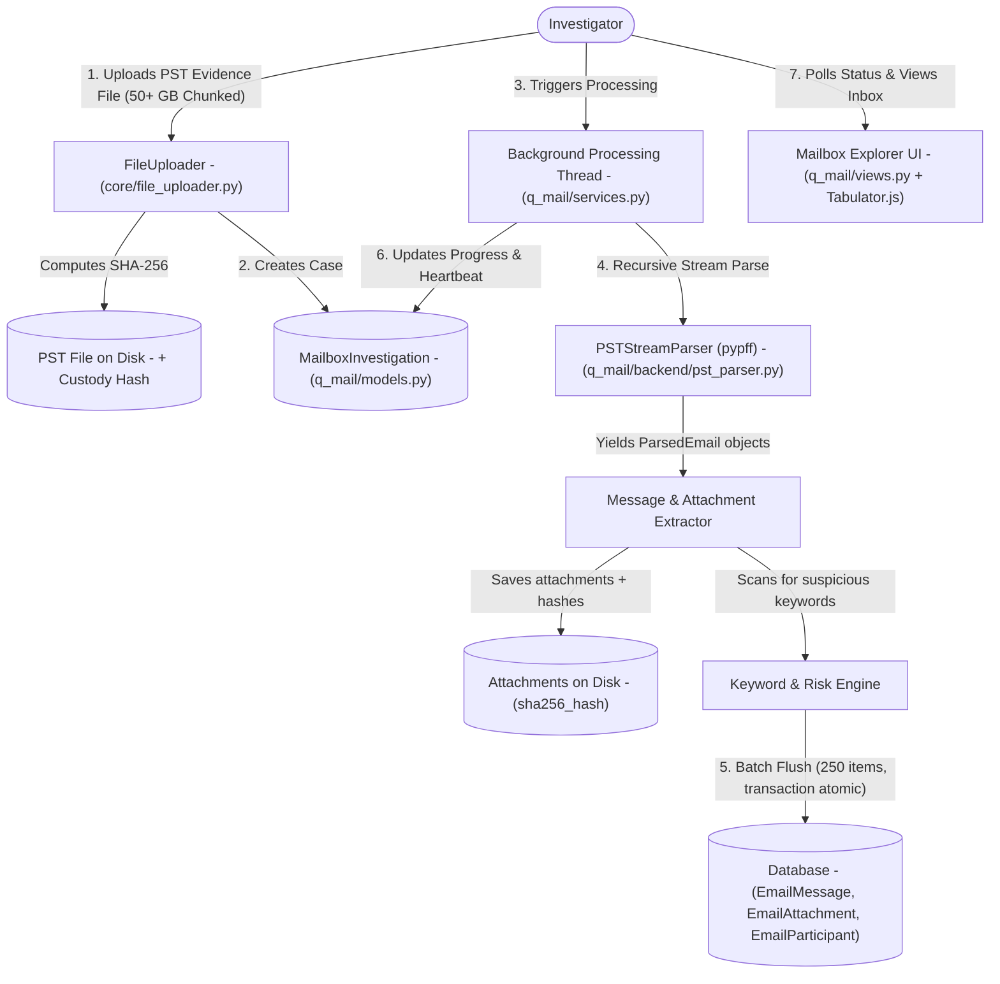
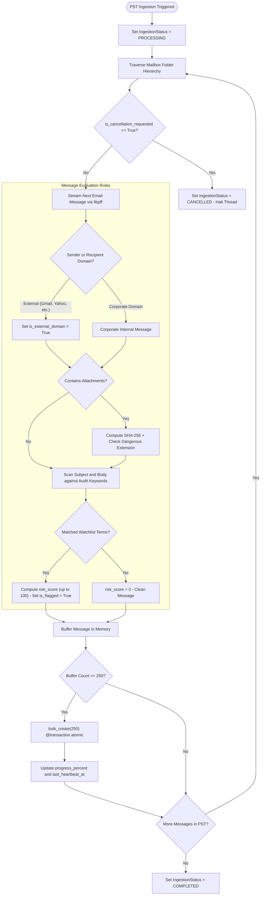

# Q-Mail — Data & Architecture Flow

> **Audience**: Anyone seeking a clear, layman-friendly explanation of how Q-Mail streams, unpacks, screens, and visualizes massive Outlook mailboxes — grounded in the actual Python codebase.

---

## 1. The Big Picture: What is `q_mail`?

In corporate investigations, **the most critical evidence often sits inside email inboxes**. Suspects discuss unauthorized payments, forward confidential blueprints, or negotiate secret vendor terms over email.

However, a corporate Outlook mailbox is typically archived into a single massive file called a **PST (Personal Storage Table)** file, often weighing **10 GB, 30 GB, or even 50+ GB**. Standard software crashes when trying to open files of this size, and standard web servers time out.

**Q-Mail is an industrial-strength email evidence laboratory**. It:
1. **Safely Streams Giant PST Archives**: Accepts massive PST files chunk-by-chunk and extracts them without loading the whole file into RAM.
2. **Maintains Digital Chain of Custody**: Hashes every evidence file and extracted attachment with SHA-256 so evidence is legally defensible in court.
3. **Reconstructs the Entire Mailbox Tree**: Recreates all folders (Inbox, Sent Items, Deleted Items, Drafts, custom archives).
4. **Performs Asynchronous Background Processing**: Operates in the background with live progress bars and heartbeats so the web application never freezes.
5. **Screens for Fraud & Collusion**: Scans subjects, message bodies, and attachments against investigation keywords, flagging high-risk emails.
6. **Maps Communication Networks**: Tracks who the suspect talked to most frequently and flags external or personal email domains (like Gmail, Yahoo, ProtonMail).

---

## 2. Architecture & File Breakdown

The `q_mail` codebase is engineered for heavy file streaming and background processing:

```
apps/q_mail/
├── models.py                   # Schemas: MailboxInvestigation, EmailMessage, EmailAttachment, EmailParticipant
├── selectors.py                # Read queries: Fast mailbox filtering, folder stats, participant summaries
├── services.py                 # Business logic: Background task worker, chunked upload handler, atomic batch writer
├── views.py                    # Controllers: Dashboard, Mailbox Detail view, progress status API, cancellation
├── urls.py                     # Route mapping: URLs connecting browser actions to view functions
├── templates/q_mail/           # UI templates: dashboard.html, investigation_detail.html
└── backend/                    # Pure parsing engine
    ├── pst_parser.py           # libpff / pypff C-library wrapper for streaming 50+ GB PST files
    └── checkpoints.py          # Resumption engine: Records folder and message offsets to recover from crashes
```

---

## 3. End-to-End Data Flow

Here is how email evidence flows through Q-Mail:



### Detailed Flow Steps:

1. **Chunked Upload & Chain of Custody (`core.file_uploader` -> `q_mail.views`)**:
   - The investigator registers an investigation under an active audit, providing the suspect's name and email.
   - The 50+ GB PST file is uploaded in 10MB chunks using `core.file_uploader.FileUploader`.
   - Upon the final chunk, the file is stream-hashed with SHA-256. A `MailboxInvestigation` record is initialized with status `PENDING`.

2. **Asynchronous Background Ingestion (`services.py`)**:
   - Processing a 50 GB file can take hours. To prevent web browser timeouts, `services.start_pst_ingestion()` spawns an asynchronous worker thread.
   - The worker periodically updates `progress_percent`, `processed_messages_count`, `current_folder`, and `last_heartbeat_at`.
   - If the investigator clicks "Cancel", `is_cancellation_requested` is flagged and the parser safely halts.

3. **C-Level Streaming Extraction (`backend/pst_parser.py`)**:
   - Instead of loading the PST into Python memory, `PSTStreamParser` wraps the high-performance C library `pypff` (libpff).
   - It traverses the PST folder hierarchy recursively (`_traverse_folder`), reading one message at a time.
   - It extracts:
     - Message metadata: Subject, Sender, To, Cc, Bcc, Sent Date, Delivery Date.
     - Content: Plaintext body and HTML body.
     - Embedded Attachments: Streamed to disk under `media/q_mail/attachments/` and hashed with SHA-256.

4. **Forensic Screening & Risk Scoring**:
   - The message subject, body, and attachment names are checked against active audit keywords.
   - Emails discussing bribes, sensitive attachments, or containing password-protected zip files receive elevated `risk_score` values.

5. **Atomic Batch Insertion (`services.py` & `models.py`)**:
   - Writing each email individually to the database would cause catastrophic disk I/O lag.
   - `services.py` buffers messages in memory and flushes them to the database in **batches of 250** using `bulk_create()` wrapped in `@transaction.atomic`.
   - It simultaneously updates `EmailParticipant` counters (total emails sent/received, first/last interaction).

6. **Interactive Mailbox Explorer UI (`views.py` & `selectors.py`)**:
   - The investigator accesses `investigation_detail_view`.
   - Using **Tabulator.js**, the investigator can navigate folders (Inbox, Sent, Deleted), search text across thousands of emails in milliseconds, preview HTML messages safely, and download attachments.

---

## 4. Business Logic Flow & Decision Rules

Q-Mail's business logic manages state machines for multi-hour background tasks, cryptographic integrity, and fraud screening across tens of thousands of emails.



### Detailed Business Rules & Logic Specifications:

| Rule Name | Trigger Condition | Logic & Thresholds | Outcome / Business Action |
| :--- | :--- | :--- | :--- |
| **Ingestion State Machine** | File upload and worker execution lifecycle | States: `PENDING` -> `UPLOADING` -> `PROCESSING` -> `COMPLETED`. On unhandled exception -> `FAILED`. If thread heartbeat expires (>15 mins without update) -> `STALLED`. | Enforces clear lifecycle visibility for long-running 50+ GB PST extractions. |
| **Graceful Thread Cancellation** | Investigator clicks "Cancel Processing" in UI | Sets `is_cancellation_requested = True`. Ingestion loop checks this flag at each message/folder boundary, closes C file handles, and exits safely. | Prevents corrupted database states and orphaned background worker threads. |
| **External Domain Flagging** | Sender or recipient email contains non-corporate domain | Compares domain with whitelist. Flags personal webmails: `@gmail.com`, `@yahoo.com`, `@hotmail.com`, `@protonmail.com`. | Sets `is_external_domain = True`. Suspects using personal emails for company business is a major leak indicator. |
| **Dangerous Attachment Quarantine** | Attachment extension matches risk criteria | Inspects file extension: `.exe`, `.scr`, `.bat`, `.vbs`, `.iso`, or encrypted `.zip`. | Flags `is_suspicious = True` and computes independent SHA-256 for courtroom evidence preservation. |
| **Email Keyword Risk Scoring** | Message subject, body, or attachment name matches watchlist | Scans against keywords (*kickback, commission, secret, cash, delete, tender*). Accumulates risk score clamped `[0, 100]`. If `risk_score >= 60`, sets `is_flagged = True`. | Automatically bubbles high-risk communication threads to the top of the investigator's inbox. |
| **Participant Interaction Matrix** | Processing messages to/from an address | Aggregates `sent_count` and `received_count`. Tracks `first_interaction` and `last_interaction` datetimes. | Builds a complete counterparty dossier showing who the suspect talked to most frequently. |
| **Database I/O Batch Throttling** | 250 messages buffered in worker RAM | Flushes records via `EmailMessage.objects.bulk_create(batch)` wrapped in `@transaction.atomic`. | Eliminates database write bottlenecks, ensuring 50,000+ emails can be saved in minutes rather than hours. |

---

## 5. Key Database Entities in `q_mail`

| Model Name | What it Stores | Why it Matters to the Investigator |
| :--- | :--- | :--- |
| `MailboxInvestigation` | Case ref, suspect name, PST file path, SHA-256 hash, ingestion status, progress % | The master case dossier for the uploaded mailbox archive. |
| `EmailMessage` | Sender, recipients, subject, body, folder path, sent date, risk score, flags | The core email record with complete content and forensic risk tags. |
| `EmailAttachment` | File name, file size, MIME type, SHA-256 hash, storage path | Digital evidence attachments extracted from emails. |
| `EmailParticipant` | Email address, display name, sent count, received count, external flag | The contact dossier showing who the suspect communicated with most. |

---

## 6. How `q_mail` Connects to Other Apps

- **To `core`**: Custodians are tied directly to `core.InvestigationProfile` and investigations are grouped under the active `core.Audit`.
- **To `q_link`**: All email senders, recipients, and external domains are fed into `q_link`. If a vendor discovered in `q_ledger` or a bank counterparty in `q_bank` exchanges secret emails with an employee, `q_link` flags a high-priority collusion alert.
- **To `q_verify`**: Attachments (PDFs, Word docs) extracted from emails can be sent to `q_verify` to check if invoices or contracts were secretly tampered with.
