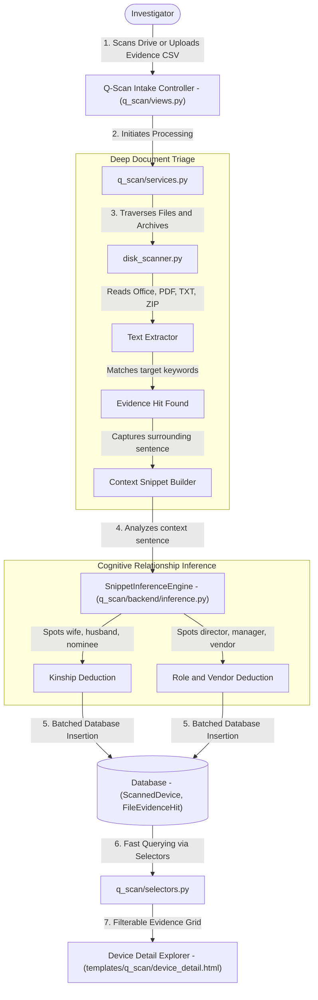
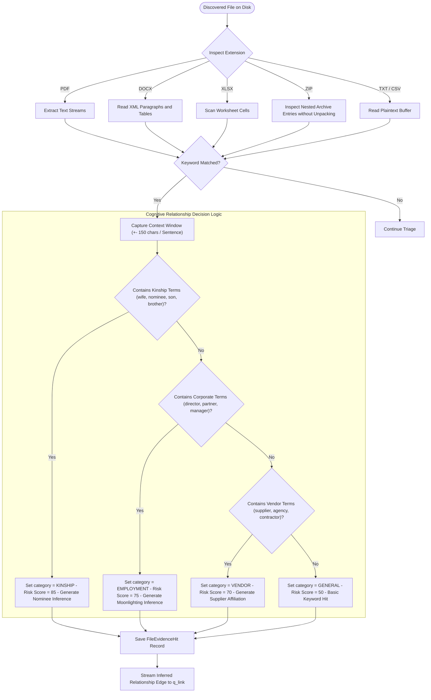

# Q-Scan — Data & Architecture Flow

> **Audience**: Anyone seeking a clear, layman-friendly explanation of how Q-Scan audits endpoint computers, searches inside documents, and automatically infers hidden relationships — grounded in the actual Python codebase.

---

## 1. The Big Picture: What is `q_scan`?

When digital forensics experts seize a suspect's laptop, corporate desktop, or external hard drive, they are faced with **hundreds of thousands of files**: PDFs, Word documents, Excel sheets, PowerPoint presentations, and nested zip files. 

Searching for evidence by manually opening every folder is impossible. Worse still, a simple filename search misses files where the suspect hid illicit details inside a document named innocent like `Q3_Notes.docx`.

**Q-Scan is a deep forensic disk scanner and relationship inference engine**. It:
1. **Audits Entire Hard Drives & Filesystems**: Traverses directory structures or ingests output logs from forensic tools (like EnCase, FTK, or live triage scripts).
2. **Peeks Inside Compressed & Complex Files**: Automatically extracts and reads text inside PDFs, Office documents (`.docx`, `.xlsx`, `.pptx`), and nested `.zip` archives.
3. **Screens for Investigation Keywords**: Flags any file containing suspect names, vendor codes, or confidential project terms.
4. **Extracts Surrounding Text Snippets**: Captures the exact sentence where the keyword was found so the auditor doesn't have to guess the context.
5. **Infers Secret Relationships (`inference.py`)**: Uses intelligent pattern matching on surrounding text to deduce facts like *"Indhumathi is the wife/nominee of Venkatesan"* or *"Sharma is Director of Metec Enterprises"*.

---

## 2. Architecture & File Breakdown

The `q_scan` codebase separates file parsing, evidence indexing, and cognitive inference into clean layers:

```
apps/q_scan/
├── models.py                  # Schemas: ScannedDevice, FileEvidenceHit
├── selectors.py               # Read queries: Fast hit filtering, device metrics, keyword aggregations
├── services.py                # Ingestion & orchestration: Imports scan logs or triggers disk triage
├── views.py                   # Controllers: Device directory, detail hit explorer, filter APIs
├── urls.py                    # Route mapping: Endpoints for dashboard and device investigations
├── templates/q_scan/          # UI templates: dashboard.html, device_detail.html
└── backend/                   # Pure forensic triage engines
    ├── disk_scanner.py        # Deep filesystem crawler & multi-format document reader (PDF, DOCX, XLSX, ZIP)
    └── inference.py           # Relationship deduction engine: Analyzes snippets for Kinship, Employment, Vendor ties
```

---

## 3. End-to-End Data Flow

Here is how endpoint evidence is discovered and interpreted by Q-Scan:



### Detailed Flow Steps:

1. **Intake & Custodian Assignment (`views.py` -> `services.py`)**:
   - The investigator registers an audited device (e.g., `LAPTOP-HYU-042`, Custodian: John Doe, Target Drive: `C:\`).
   - The investigator uploads a triage findings file or runs a targeted search against active keywords.

2. **Multi-Format Deep Inspection (`backend/disk_scanner.py`)**:
   - The engine iterates through files. Rather than only checking filenames, it inspects file contents:
     - **PDFs**: Extracts embedded text streams.
     - **Word (`.docx`)**: Reads internal XML document paragraphs and tables.
     - **Excel (`.xlsx`)**: Reads cell data across all worksheets.
     - **Presentations (`.pptx`)**: Scans slide text boxes and speaker notes.
     - **Zip Archives (`.zip`)**: Opens the archive in memory and inspects nested documents without unpacking gigabytes to disk.

3. **Context Snippet Extraction**:
   - When a keyword matches (e.g. "Indhumathi"), the scanner does not simply say "Match found on line 42".
   - It captures the **surrounding text snippet** (e.g., *"Nominee details: Name: Indhumathi, Relationship: Wife, Share: 100%"*).

4. **Automated Forensic Inference (`backend/inference.py`)**:
   - The captured snippet is evaluated by `SnippetInferenceEngine`.
   - The engine checks for relationship markers:
     - **Kinship / Family**: Matches terms like *spouse, wife, husband, nominee, son, daughter, father, mother, brother, dependent*.
     - **Employment / Corporate Role**: Matches terms like *director, proprietor, partner, manager, authorized signatory*.
     - **Vendor Affiliation**: Matches terms like *supplier, vendor, agency, contractor*.
   - If a relationship is detected, it populates:
     - `inference`: e.g., *"Indhumathi is nominee/wife of auditee"*
     - `inference_category`: `KINSHIP`, `EMPLOYMENT`, or `VENDOR`
     - Elevates the `risk_score` to reflect a high-priority conflict of interest.

5. **Database Persistence & Explorer UI (`selectors.py` & `models.py`)**:
   - Results are saved as `FileEvidenceHit` records linked to the `ScannedDevice`.
   - The UI presents an interactive evidence grid powered by **Tabulator.js**, allowing the auditor to filter by `Inference Category` (e.g. show me all `KINSHIP` findings) and click to view the full file path and text snippet.

---

## 4. Business Logic Flow & Decision Rules

Q-Scan does not merely find words; it analyzes the grammatical context surrounding those words to deduce real-world conflicts of interest.



### Detailed Business Rules & Logic Specifications:

| Rule Name | Trigger Condition | Logic & Thresholds | Outcome / Business Action |
| :--- | :--- | :--- | :--- |
| **Non-Extractive Archive Inspection** | Filesystem encounters `.zip` archive | Opens byte stream via `zipfile.ZipFile` in memory; iterates member entries without unzipping to disk. | Eliminates disk space exhaustion attacks (zip bombs) and speeds up triage 10x. |
| **Snippet Boundary Window** | Keyword match occurs inside document text | Captures the entire enclosing sentence or a `[-150, +150]` character window around the match point. | Preserves the necessary grammatical context for the auditor and AI models. |
| **Kinship Relationship Deduction** | Snippet contains family terms near the target name | Scans `KINSHIP_TERMS` (*spouse, wife, husband, nominee, son, daughter, child, father, mother, brother, sister, relative, dependent, family*). | Sets `inference_category = KINSHIP` and `risk_score = 85`. Exposes hidden family beneficiary accounts. |
| **Corporate Moonlighting Deduction** | Snippet contains executive titles | Scans for designations (*director, proprietor, partner, manager, authorized signatory, ceo*). | Sets `inference_category = EMPLOYMENT` and `risk_score = 75`. Identifies undisclosed outside business interests. |
| **Vendor Affiliation Deduction** | Snippet contains commercial supply terms | Scans for affiliation words (*supplier, vendor, agency, contractor, logistics*). | Sets `inference_category = VENDOR` and `risk_score = 70`. Flags procurement conflicts of interest. |
| **Single-Word Entity Resolution** | Extracted name consists of a single proper noun | Cross-checks against active `InvestigationProfile`s using `core.fuzzy`. If matched, links to the master profile. | Automatically maps casual first names found on laptops to formal employee files. |

---

## 5. Key Database Entities in `q_scan`

| Model Name | What it Stores | Why it Matters to the Investigator |
| :--- | :--- | :--- |
| `ScannedDevice` | Hostname, custodian name, drive letter, total files scanned, total hits | Dossier for the computer, hard drive, or disk image examined. |
| `FileEvidenceHit` | File path, filename, matched keyword, match type, snippet, inference, risk score | The atomic evidence hit with automated relationship deductions and context. |

---

## 6. How `q_scan` Connects to Other Apps

- **To `core`**: Custodians link to `core.InvestigationProfile`, and keyword lists are pulled from the active investigation profile.
- **To `q_link`**: Inferred kinship relationships (e.g. *Indhumathi is wife of Venkatesan*) are fed directly into `q_link` to create family ties in the cross-module fraud graph.
- **To `q_bank`**: If Q-Scan finds a personal bank account number or nominee name on a laptop, Q-Bank can immediately search for that account in bank records.
