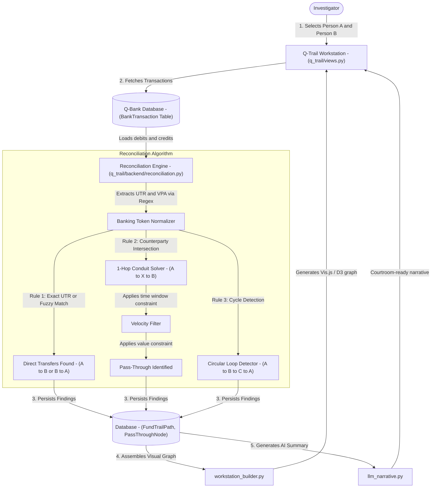
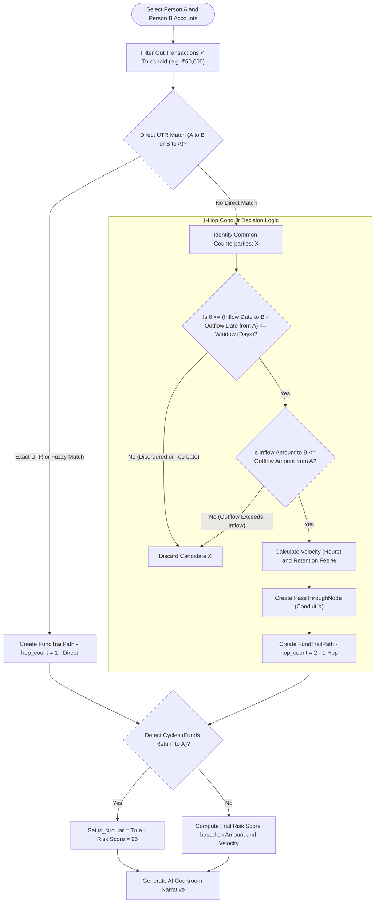

# Q-Trail — Data & Architecture Flow

> **Audience**: Anyone seeking a clear, layman-friendly explanation of how Q-Trail traces funds, catches pass-through intermediaries, and exposes circular money laundering — grounded in the actual Python codebase.

---

## 1. The Big Picture: What is `q_trail`?

When corrupt actors transfer bribes or kickbacks, they rarely send money directly from their personal bank account to the recipient's personal account (e.g., Person A -> Person B). That would be too obvious.

Instead, they use **conduits and shell intermediaries**:
- **The "Pass-Through Conduit" (1-Hop Transfer)**: Person A sends ₹10,00,000 to "Sharma Trading" (Person X). Within 2 hours, "Sharma Trading" sends ₹9,50,000 to Person B (keeping a 5% commission).
- **Circular Round-Tripping**: Money travels from Person A to Company B, to Company C, and eventually loops back to Person A's offshore account to create fake business expenses.

**Q-Trail is an automated money trail hunter and network reconciliation engine**. It:
1. **Connects Disparate Bank Statements**: Pulls transactions from multiple bank accounts (HDFC, ICICI, SBI) across different individuals.
2. **Finds Direct Hidden Transfers**: Links transactions across banks using Unique Transaction References (UTRs), UPI reference numbers, or fuzzy date/amount pairing.
3. **Identifies 1-Hop & Multi-Hop Conduits (A -> X -> B)**: Automatically discovers intermediate entities who received money from the sender and quickly passed it to the target within a narrow time window.
4. **Calculates Conduit Velocity & Retention**: Measures exactly how fast money passed through the middleman (in hours) and how much commission they pocketed.
5. **Generates AI Investigative Narratives**: Produces executive courtroom-ready narratives explaining how the kickback scheme was orchestrated.

---

## 2. Architecture & File Breakdown

The `q_trail` codebase is organized into algorithmic reconciliation, network graph construction, and AI narrative synthesis:

```
apps/q_trail/
├── models.py                     # Schemas: CaseDossier, FundTrailPath, PassThroughNode
├── selectors.py                  # Read queries: Case dossiers, trail graph queries, pass-through metrics
├── services.py                   # Orchestration: Executes reconciliation between accounts, persists paths
├── views.py                      # Controllers: Money trail dashboard, interactive workstation canvas
├── urls.py                       # Route mapping: Endpoints for trail analysis and graph rendering
├── templates/q_trail/            # UI templates: dashboard.html with interactive graph canvas
├── prompts/                      # LLM Prompts: loop_narrative_system.txt, loop_narrative_user.txt
└── backend/                      # Algorithmic engine
    ├── reconciliation.py         # 1,300+ line matching engine: UTR regex, direct joins, 1-hop conduit solver
    ├── workstation_builder.py    # Formats nodes, edges, and flow matrices for interactive frontend canvas
    └── llm_narrative.py          # AI Narrative Generator: Translates graph math into plain English summaries
```

---

## 3. End-to-End Data Flow

Here is how money trails are unraveled inside Q-Trail:



### Detailed Flow Steps:

1. **Investigation Selection (`views.py`)**:
   - The investigator opens the Q-Trail canvas and selects the originating suspect (Person A) and the target recipient (Person B) along with their audited bank accounts from `q_bank`.
   - The investigator sets detection parameters: the maximum time window (e.g. within 3 days or 7 days) and minimum transaction threshold (e.g. ₹50,000).

2. **Regex-Powered Token Extraction (`backend/reconciliation.py`)**:
   - `reconciliation.py` parses thousands of raw narrations looking for:
     - **UTR Patterns**: 12-digit numeric UPI/IMPS RRNs or alphanumeric NEFT/RTGS codes (`REGEX_UTR`).
     - **VPA Handles**: Virtual Payment Addresses like `user@okhdfcbank` or `merchant@icici`.
     - **Counterparty Names**: Stripping bank noise words (`TRANSFER`, `NEFT`, `IMPS`, `CR`, `DR`).

3. **Rule 1: Direct Transfer Matching**:
   - Checks if a debit in Person A's account shares the exact same UTR as a credit in Person B's account.
   - If UTR is truncated by the bank, a fallback fuzzy match compares transaction dates, identical amounts, and narration tokens.

4. **Rule 2: 1-Hop Intermediate Conduit Solving (A -> X -> B)**:
   - Finds every counterparty `X` who received an outflow from Person A (`A -> X`).
   - Finds every counterparty `X` who sent an inflow to Person B (`X -> B`).
   - Computes the intersection: where counterparty `X` appears in both lists!
   - Applies strict forensic constraints:
     - **Temporal Sequence**: `0 <= (Inflow Date - Outflow Date) <= time_window_days` (Person X must receive from A *before* sending to B).
     - **Value Constraint**: Person X passes on the bulk of the money, retaining an identifiable commission (`retention_pct`).
     - Calculates the **Pass-Through Velocity** (e.g. money moved across in 4.2 hours).

5. **Rule 3: Circular Loop Detection**:
   - Analyzes directed network cycles where funds originate from an entity, travel through multiple nodes, and loop back to the originator or a related family member.

6. **Database Persistence & AI Narrative Synthesis**:
   - Identified trails are saved into `FundTrailPath`, and each intermediate conduit is recorded in `PassThroughNode`.
   - `llm_narrative.py` feeds the structured path data into a prompt template (`loop_narrative_user.txt`) to generate a clear summary (e.g. *"On March 12, Person A transferred ₹10,00,000 to conduit entity Sharma Enterprises. Within 6 hours, Sharma Enterprises forwarded ₹9,50,000 to Person B, retaining ₹50,000 (5%) as an intermediary fee."*).

---

## 4. Business Logic Flow & Decision Rules

Q-Trail's reconciliation logic acts as an algorithmic financial detective, deciding whether two seemingly unrelated bank records belong to the same coordinated transaction.



### Detailed Business Rules & Logic Specifications:

| Rule Name | Trigger Condition | Logic & Thresholds | Outcome / Business Action |
| :--- | :--- | :--- | :--- |
| **Minimum Amount Threshold Filter** | User specifies `min_threshold` (default: ₹50,000) | Filter: `amount >= min_threshold`. Discards petty personal expenses (groceries, fuel). | Focuses investigative computing power exclusively on material fraud and bribe amounts. |
| **Rule 1: Direct UTR Join** | Person A debit and Person B credit share exact UTR | Primary: `deb_utr == cred_utr`. Fallback: `abs(deb_date - cred_date) <= 1 day` AND `deb_amt == cred_amt` AND token overlap > 60%. | Instantly establishes direct money transfers between the two suspects (`hop_count = 1`). |
| **Rule 2: Temporal Sequence Window** | Counterparty X receives from A and sends to B | Must satisfy: `T_received_by_X <= T_sent_to_B` AND `(T_sent_to_B - T_received_by_X) <= time_window_days` (default 3 to 7 days). | Proves causality: X received money from A *before* sending it to B. |
| **Rule 2: Conduit Value Constraint** | Outflow from X to B compared to Inflow from A to X | Must satisfy: `Amt_sent_to_B <= Amt_received_from_A`. | Proves the money sent to B originated from the funds supplied by A. |
| **Conduit Retention Commission** | Identified pass-through conduit X | Formula: `retention_pct = ((Amt_A_in - Amt_B_out) / Amt_A_in) * 100`. | Quantifies the exact fee or cut pocketed by the intermediary (e.g. 5% commission). |
| **Conduit Velocity Index** | Time taken for funds to transit middleman X | Formula: `velocity_hours = (T_sent_to_B - T_received_by_X).total_seconds() / 3600`. | Rapid velocity (< 12 hours) provides strong evidence of a pre-planned conduit rather than genuine commerce. |
| **Rule 3: Circular Round-Tripping** | Money trail path forms a directed cycle | Network traversal detects if destination entity matches origin or related company. Sets `is_circular = True`. | Elevates `risk_score` to **95** (CRITICAL). Flags fake invoice expense round-tripping. |
| **AI Narrative Generation** | Trail path saved with identified nodes | Injects amounts, timestamps, velocity, and retention into `prompts/loop_narrative_user.txt`. | Generates a clear executive summary for audit committees and legal teams. |

---

## 5. Key Database Entities in `q_trail`

| Model Name | What it Stores | Why it Matters to the Investigator |
| :--- | :--- | :--- |
| `CaseDossier` | Case number (`TR-2026-001`), title, lead investigator, status | The investigation binder tracking fund-tracing operations. |
| `FundTrailPath` | Source entity, destination entity, total amount, hop count, circular flag, risk score | The completed money route connecting two people across one or multiple hops. |
| `PassThroughNode` | Conduit name, inflow amount, outflow amount, retention %, timestamps | Detailed forensic profile of the middleman who laundered or routed the money. |

---

## 6. How `q_trail` Connects to Other Apps

- **To `q_bank`**: Relies 100% on `q_bank`'s normalized `BankTransaction` ledger records.
- **To `core`**: Connects money trail nodes to registered `core.InvestigationProfile` auditees.
- **To `q_link`**: Inferred multi-hop relationships (`CONDUIT_TO`, `TRANSFERRED_FUNDS`) are fed into `q_link`'s global knowledge graph to link money movements with email and chat evidence.
