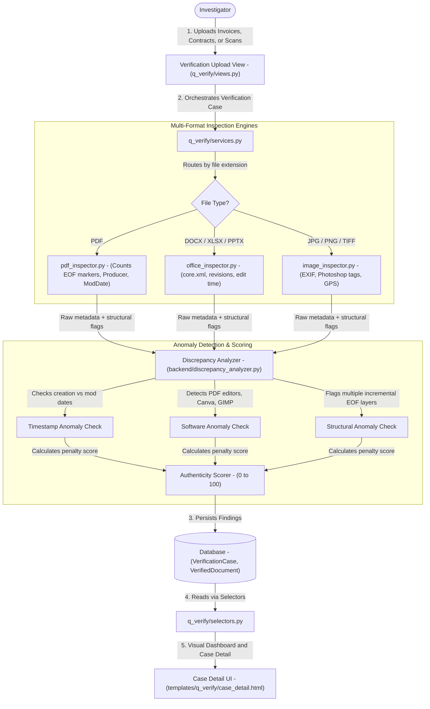
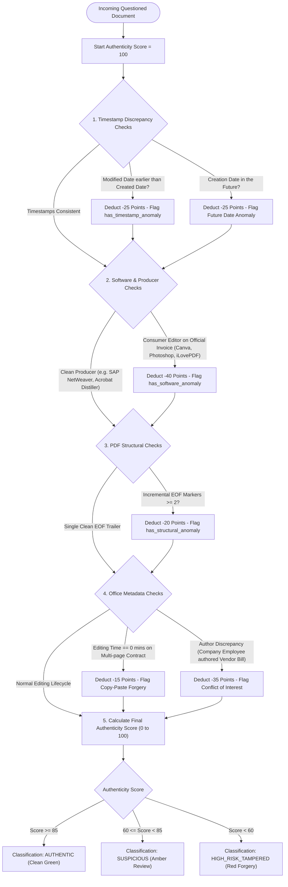

# Q-Verify — Data & Architecture Flow

> **Audience**: Anyone seeking a clear, layman-friendly explanation of how Q-Verify detects document tampering, analyzes metadata discrepancies, and scores document authenticity — grounded in the actual Python codebase.

---

## 1. The Big Picture: What is `q_verify`?

In corporate fraud and procurement corruption, suspects frequently **forge or doctor documents**:
- They take a vendor invoice, open it in a PDF editor, change the price from ₹1,00,000 to ₹10,00,000, and submit it for payment.
- They alter contract dates to make it appear an agreement was signed before a tender closed.
- They edit bank deposit slips in Photoshop.

When printed or viewed casually on screen, these fake documents look 100% genuine. However, **every digital file leaves hidden invisible digital fingerprints (metadata)** inside its binary code. For example:
- A PDF invoice might claim it was created in 2022, but its internal binary header reveals it was edited with `Adobe Acrobat Pro` or `iLovePDF` yesterday!
- A Word document might list the author as "Vendor Inc.", but the internal XML metadata reveals it was typed by a company employee on their personal laptop.

**Q-Verify is an automated document authenticity laboratory**. It:
1. **Performs Structural PDF Dissection**: Counts incremental PDF update blocks (EOF markers) to discover if pages were edited or overwritten after initial creation.
2. **Inspects Office Document XML**: Extracts deep metadata from Word, Excel, and PowerPoint files (`docProps/core.xml`, `docProps/app.xml`), uncovering total editing time, revision numbers, and original template paths.
3. **Analyzes Image EXIF Metadata**: Scans images for GPS coordinates, camera models, and signs of photo editing tools (Photoshop, Canva, GIMP).
4. **Calculates Timestamp Discrepancies**: Compares file-system modification dates against internal embedded metadata dates to catch retroactive backdating.
5. **Assigns an Authenticity Score (0 to 100)**: Grades every file as `AUTHENTIC` (Clean), `SUSPICIOUS` (Discrepancies found), or `HIGH_RISK_TAMPERED`.

---

## 2. Architecture & File Breakdown

The `q_verify` codebase is engineered around deep file-format inspection and cross-discrepancy heuristics:

```
apps/q_verify/
├── models.py                       # Schemas: VerificationCase, VerifiedDocument
├── selectors.py                    # Read queries: Case summaries, authenticity metrics, anomaly filters
├── services.py                     # Business workflow: Multi-document ingestion, analysis orchestration
├── views.py                        # Controllers: Dashboard, Case Detail explorer, document upload APIs
├── urls.py                         # Route mapping: Endpoints for verification audits
├── templates/q_verify/             # UI templates: dashboard.html, case_detail.html
└── backend/                        # Forensic inspection engines
    ├── pdf_inspector.py            # PDF xref and incremental update counter, header and trailer parser
    ├── office_inspector.py         # OOXML metadata unpacker (core.xml, app.xml, revision counters)
    ├── image_inspector.py          # EXIF reader: Camera tags, GPS coordinates, editing software markers
    ├── discrepancy_analyzer.py     # Cross-examination brain: Scores authenticity based on timing and tool conflicts
    ├── ner_extractor.py            # Extracts entities from document text
    └── content_search.py           # Screens document body for audit keywords
```

---

## 3. End-to-End Data Flow

Here is how documents are audited for authenticity inside Q-Verify:



### Detailed Flow Steps:

1. **Case Registration & Ingestion (`views.py` -> `services.py`)**:
   - The investigator creates a `VerificationCase` assigned to a target custodian or vendor under investigation.
   - Questioned documents (invoices, tender agreements, purchase quotes) are uploaded.

2. **Specialized Format Inspection**:
   - **PDF Inspection (`pdf_inspector.py`)**:
     - Scans the binary byte stream for EOF trailer markers. A normal PDF has one EOF marker. If a PDF has 2 or more, it means the file was opened, modified, and saved over in an incremental update block!
     - Reads the `/Producer`, `/Creator`, `/CreationDate`, and `/ModDate` dictionary tags.
   - **Office Document Inspection (`office_inspector.py`)**:
     - Microsoft Office files are secretly zipped archives. The inspector unzips `docProps/core.xml` and `docProps/app.xml`.
     - Extracts the true internal author, last modified by, total editing time (in minutes), revision number, and software application.
   - **Image Inspection (`image_inspector.py`)**:
     - Extracts EXIF headers. Flags if software like *Adobe Photoshop*, *Canva*, or *GIMP* appears in the software string.

3. **Discrepancy Analysis & Tampering Detection (`backend/discrepancy_analyzer.py`)**:
   - The analyzer compares all extracted facts:
     - **Future Date Anomaly**: If the internal creation date is in the future.
     - **Inverted Timeline Anomaly**: If the file was "modified" *before* it was "created".
     - **Tool Mismatch Anomaly**: If an invoice allegedly issued by an enterprise ERP (like SAP) has `/Producer (iLovePDF)` or `/Creator (Canva)`.
     - **Heavy Incremental Updates**: If an invoice has multiple structural revision layers.

4. **Authenticity Score Calculation**:
   - Every document starts with a clean score of **100**.
   - Penalties are deducted based on detected red flags:
     - Major discrepancy (e.g., photo editing software on official invoice): **-40 points**.
     - Timestamp inversion (mod before creation): **-25 points**.
     - Incremental binary tampering: **-20 points**.
   - **Final Classification**:
     - **85 - 100**: `AUTHENTIC` (Green)
     - **60 - 84**: `SUSPICIOUS` (Amber)
     - **Below 60**: `HIGH_RISK_TAMPERED` (Red)

5. **Presentation in the Interactive Dossier (`templates/q_verify/case_detail.html`)**:
   - Investigators can see an instant visual breakdown: Average Authenticity Score, Tampered Document Count, and a side-by-side comparison table of File System Dates vs Internal Metadata Dates.

---

## 4. Business Logic Flow & Decision Rules

Q-Verify uses a forensic deduction matrix to calculate whether a document is genuine or has been artificially altered.



### Detailed Business Rules & Logic Specifications:

| Rule Name | Trigger Condition | Logic & Thresholds | Outcome / Business Action |
| :--- | :--- | :--- | :--- |
| **Inverted Timestamp Discrepancy** | `meta_modified_at < meta_created_at` | True modification cannot precede creation. Sets `has_timestamp_anomaly = True`. | Deducts **-25 points**. Strong evidence of manual metadata tampering or clock rollback. |
| **Future Date Anomaly** | `meta_created_at > datetime.now()` | Digital file timestamp is set in the future. | Deducts **-25 points**. Proves the creator altered system clocks to backdate/postdate documents. |
| **Consumer Tool on Official Bill** | PDF `/Producer` or `/Creator` contains consumer tools | Scans against consumer editors: *Canva, Photoshop, iLovePDF, Sejda, PDFescape, Nitro, Foxit*. | Deducts **-40 points**. Enterprise vendors issue bills from ERPs; editing in Canva proves manual alteration. |
| **Incremental PDF Update (EOF)** | PDF binary contains multiple `EOF` markers | Scans binary stream for trailer count `n >= 2`. Sets `has_structural_anomaly = True`. | Deducts **-20 points**. Proves content was appended over original text to mask amounts or names. |
| **Abnormal Editing Time** | Word/Excel `editing_time_minutes` anomaly | A 10+ page contract with `editing_time_minutes == 0` or `< 2` minutes. | Deducts **-15 points**. Indicates fraudulent template duplication or fake quote fabrication. |
| **Internal Author Conflict** | Word `meta_author` matches company staff | Compares `meta_author` against internal employee roster. | Deducts **-35 points**. Proves the company employee drafted the vendor's tender bid on their behalf! |
| **Authenticity Tier Classification** | Final score calculation: `100 - sum(penalties)` | `score >= 85` = `AUTHENTIC`, `60 - 84` = `SUSPICIOUS`, `< 60` = `HIGH_RISK_TAMPERED`. | Sets document badge color and triggers high-risk alerts in `q_link`. |

---

## 5. Key Database Entities in `q_verify`

| Model Name | What it Stores | Why it Matters to the Investigator |
| :--- | :--- | :--- |
| `VerificationCase` | Case ref (`VER-2026-001`), custodian, total docs, average authenticity score | Groups audited documents under an investigation mandate. |
| `VerifiedDocument` | Filename, SHA-256 hash, metadata dates, author, producer, authenticity score, anomalies list | The audited document with line-by-line forensic tampering evidence and scores. |

---

## 6. How `q_verify` Connects to Other Apps

- **To `core`**: Custodians link to `core.InvestigationProfile`, and cases roll up into `core.Audit`.
- **To `q_mail`**: Email attachments extracted from suspect inboxes in `q_mail` can be seamlessly inspected by `q_verify`.
- **To `q_ledger`**: Invoices submitted for SAP procurement can be cross-examined by `q_verify` to ensure vendor invoices were not forged or modified in Canva/Photoshop.
- **To `q_link`**: Discovered document authors and tampered invoice findings are sent to `q_link` as high-risk intelligence alerts.
