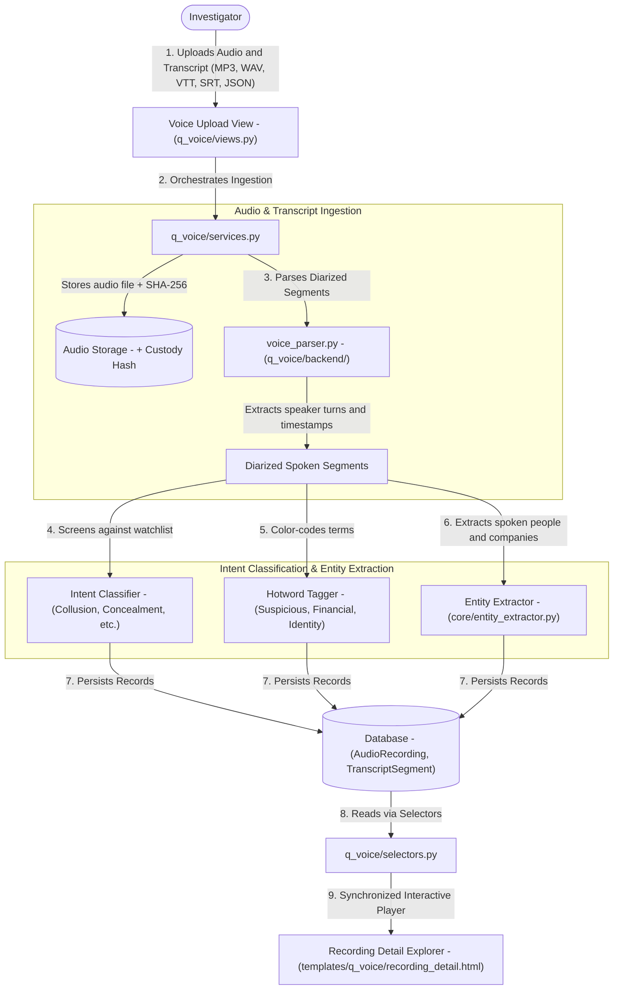
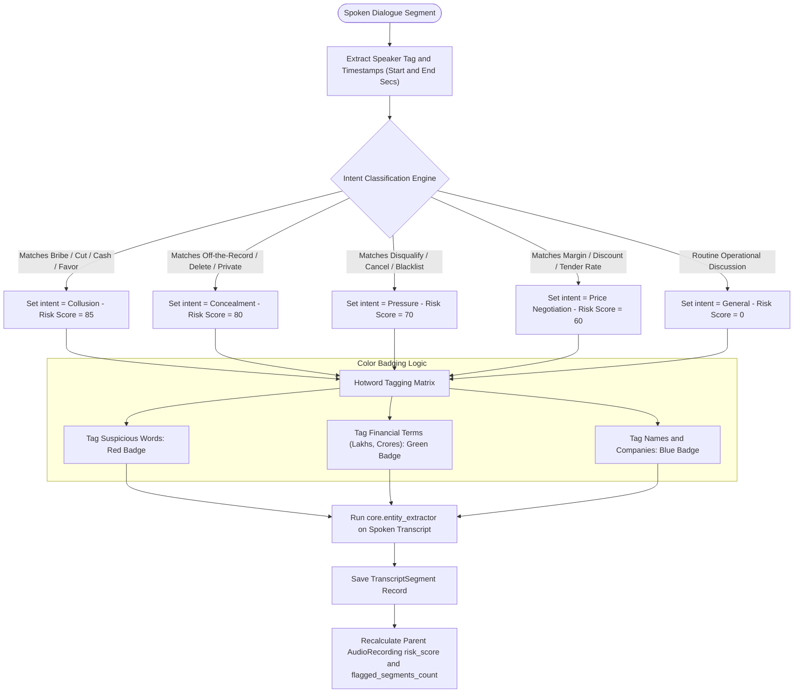

# Q-Voice — Data & Architecture Flow

> **Audience**: Anyone seeking a clear, layman-friendly explanation of how Q-Voice ingests wiretaps and audio recordings, separates speakers, detects suspicious conversation intents, and maps spoken entities — grounded in the actual Python codebase.

---

## 1. The Big Picture: What is `q_voice`?

Audio evidence — such as recorded phone calls, wiretaps, voice notes, or intercepted meetings — provides **unfiltered proof of intent**. While suspects might be careful about what they put into formal emails, they often let their guard down on phone calls:
- They discuss cash kickbacks (*"I will send 5 lakhs in cash through my brother"*).
- They coordinate bid rigging (*"Quote 12% higher so our favored vendor gets the contract"*).
- They attempt concealment (*"Don't talk about this on official email, call me on WhatsApp"*).

However, listening to **hundreds of hours of audio recordings** is exhausting and inefficient.

**Q-Voice is an automated forensic audio analyst and intent screener**. It:
1. **Ingests Audio & Diarized Transcripts**: Accepts audio recordings (`.wav`, `.mp3`, `.m4a`) paired with subtitle/transcript formats (`.vtt`, `.srt`, `.json`, `.csv`, `.txt`).
2. **Separates Speakers (Speaker Diarization)**: Recognizes who spoke when (e.g. `[00:14] Speaker 1 (Auditee): ...`, `[00:22] Speaker 2 (Vendor): ...`).
3. **Classifies Conversational Intent**: Categorizes spoken lines into forensic intent buckets: `Collusion`, `Price Negotiation`, `Concealment`, `Pressure`, or `Procurement`.
4. **Highlights Hotwords**: Automatically color-codes spoken words into **Suspicious Terms**, **Financial Figures** (Lakhs, Crores), and **Identities** (people and company names).
5. **Extracts Spoken Entities**: Uses `core.entity_extractor` to discover spoken family names, shell companies, and phone numbers mentioned in the conversation.

---

## 2. Architecture & File Breakdown

The `q_voice` codebase is structured to handle multimodal audio playback and textual transcript analytics:

```
apps/q_voice/
├── models.py                     # Schemas: AudioRecording, TranscriptSegment, VoiceWatchlistRule
├── selectors.py                  # Read queries: Fast recording lookups, segment filtering, intent metrics
├── services.py                   # Business workflows: Ingests audio files, coordinates entity extraction
├── views.py                      # Controllers: Voice dashboard, recording detail player, custodian explorer
├── urls.py                       # Route mapping: Endpoints for audio streaming and transcript filtering
├── templates/q_voice/            # UI templates: dashboard.html, recording_detail.html (with synchronized audio player)
└── backend/                      # Speech and transcript parsing engines
    └── voice_parser.py           # VTT/SRT/JSON parser, timestamp mapper, hotword tagger, and intent classifier
```

---

## 3. End-to-End Data Flow

Here is how audio evidence is processed and audited in Q-Voice:



### Detailed Flow Steps:

1. **Intake & Audio Hashing (`views.py` -> `services.py`)**:
   - The investigator uploads the audio file alongside its transcript (WebVTT, SRT, or JSON).
   - An `AudioRecording` record is created, generating a SHA-256 hash of the audio file to preserve the chain of custody.

2. **Diarization & Timestamp Parsing (`backend/voice_parser.py`)**:
   - The parser reads the subtitle/transcript file, breaking the call into timestamped dialogue chunks.
   - For each line, it records:
     - `speaker_tag`: Identifier of who spoke (e.g. "Speaker 1", "Auditee", "Caller").
     - `start_time_seconds` and `end_time_seconds`: Exact playback timestamps.
     - `text_content`: The spoken text.

3. **Intent Detection & Risk Scoring**:
   - Every spoken segment is evaluated against forensic keywords:
     - **Collusion / Kickback**: Words like *cut, percentage, cash, under-the-table, favor*.
     - **Concealment**: Words like *off the record, don't email, delete message, private line*.
     - **Pressure / Coercion**: Words like *cancel contract, disqualify, blacklist*.
     - **Price Negotiation**: Words like *margin, quote, discount, tender rate*.
   - Segments matching these patterns are assigned an `IntentCategory` and an elevated `risk_score`.

4. **Hotword Tagging & Entity Recognition (`backend/voice_parser.py` & `core.entity_extractor`)**:
   - `tag_transcript_detections()` injects interactive badges into the transcript text:
     - **Suspicious Tags** (Red): Words indicating fraud or illicit agreements.
     - **Financial Tags** (Green): Mentions of Lakhs, Crores, advance payments, account transfers.
     - **Identity Tags** (Blue): Names of people and companies spoken during the call.
   - `extract_entities_from_transcript_segments()` pulls mentioned proper nouns into the active investigation dossier.

5. **Synchronized Playback UI (`templates/q_voice/recording_detail.html`)**:
   - The frontend includes an interactive **HTML5 audio player** linked to the transcript.
   - When the investigator clicks on any flagged transcript sentence, the audio automatically jumps to that exact second, letting the auditor hear the suspect's voice and tone firsthand!

---

## 4. Business Logic Flow & Decision Rules

Q-Voice evaluates the conversational semantics of spoken dialogue to classify intent and prioritize intercepted audio calls.



### Detailed Business Rules & Logic Specifications:

| Rule Name | Trigger Condition | Logic & Thresholds | Outcome / Business Action |
| :--- | :--- | :--- | :--- |
| **Speaker Diarization Alignment** | Ingestion of WebVTT / SRT / JSON transcripts | Maps timestamp intervals `[start_time, end_time]` to speaker strings. Handles fractional seconds accurately. | Creates playable time offsets synchronized with the audio player. |
| **Collusion & Bribery Intent** | Spoken line contains kickback vocabulary | Matches keywords: *cut, percentage, cash, under-the-table, favor, settlement, arrangement*. | Sets `detected_intent = Collusion` and `risk_score = 85`. High-priority alert. |
| **Concealment Intent** | Spoken line suggests evading scrutiny | Matches keywords: *off the record, don't email, delete message, private line, personal phone, signal, whatsapp*. | Sets `detected_intent = Concealment` and `risk_score = 80`. Identifies conscious guilt. |
| **Coercion & Pressure Intent** | Spoken line contains threats | Matches keywords: *cancel contract, disqualify, blacklist, penalty, terminate, report*. | Sets `detected_intent = Pressure` and `risk_score = 70`. Flags vendor extortion. |
| **Hotword Tri-Color Tagging** | Spoken words match financial or suspicious taxonomy | Injects HTML tags: `suspicious` (Red: fraud terms), `financial` (Green: currency/lakhs), `identity` (Blue: counterparties). | Renders visual color-coded badges in the transcript viewer for rapid skimming. |
| **Spoken Entity Extraction** | Spoken turn contains proper nouns | Feeds line to `core.entity_extractor.extract_entities_from_transcript_segments()`. | Extracts counterparties, bank accounts, and family names mentioned out loud. |
| **Recording Risk Elevation** | Audio recording contains flagged segments | Aggregates `flagged_segments_count`. Sets `risk_score = max(segment_risk)`. | Positions the call in the investigator's priority review queue. |

---

## 5. Key Database Entities in `q_voice`

| Model Name | What it Stores | Why it Matters to the Investigator |
| :--- | :--- | :--- |
| `AudioRecording` | Call ref (`CALL-2026-001`), custodian, duration, audio path, SHA-256, risk score | The master recording file container with aggregate risk indicators. |
| `TranscriptSegment` | Recording, speaker tag, start/end seconds, text, detected intent, flagged words, risk score | The individual spoken utterance with exact timestamps and intent classifications. |
| `VoiceWatchlistRule` | Keyword, category (`Collusion`, `Bribery`), risk weight | Custom screening rules used to detect illicit intent in speech. |

---

## 6. How `q_voice` Connects to Other Apps

- **To `core`**: Custodians are mapped to `core.InvestigationProfile`, and call cases are linked to the active `core.Audit`.
- **To `q_link`**: Speakers and mentioned counterparties are fed into `q_link`'s knowledge graph under the `MENTIONED_IN` relationship.
- **To `q_bank`**: If a suspect mentions an amount on a call (*"I sent 2 lakhs yesterday"*), Q-Bank can immediately search for a matching transaction on that date.
