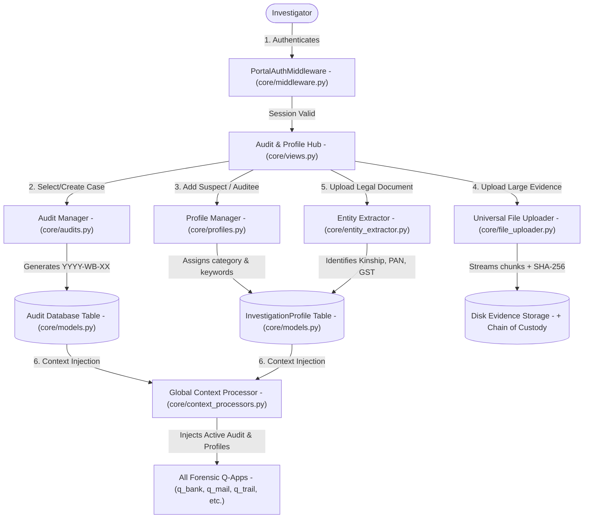
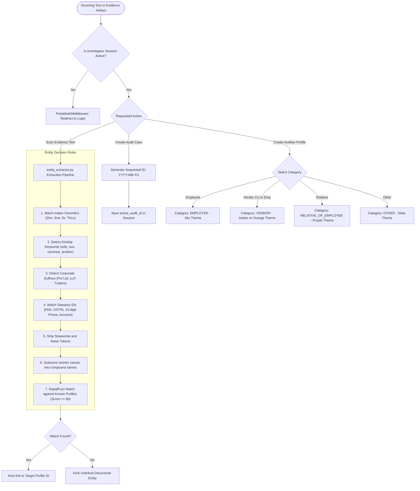

# Core App — Data & Architecture Flow

> **Audience**: Anyone who wants to understand how the ForensiQ system works under the hood — written in plain, simple English with technical precision based on the actual codebase.

---

## 1. The Big Picture: What is `core`?

Imagine ForensiQ as a **high-tech detective headquarters**. Before detectives can investigate bank accounts, emails, or phone taps, the headquarters needs:
1. **A Secure Front Door**: Ensuring only authorized investigators can enter (`PortalAuthMiddleware`, `portal_login_view`).
2. **Master Case Files**: An official ledger where every investigation is registered under a case code like `2026-WB-01` (`Audit` model).
3. **The Suspect & Target Dossier**: A central rolodex of who is being investigated — whether they are an employee, a vendor, or a family member (`InvestigationProfile` model).
4. **An Evidence Intake Vault**: A specialized heavy-duty conveyor belt that can accept massive 50+ GB files without breaking down, calculating forensic digital fingerprints (SHA-256) so evidence is tamper-proof (`FileUploader`).
5. **An AI Smart Reader**: An intelligent text scanner trained specifically on Indian names, honorifics, family relations, and tax IDs to spot people and connections across all evidence (`entity_extractor.py`).
6. **A Universal Spell-Checker / Matcher**: A fuzzy matching engine that spots names even if they are slightly misspelled or abbreviated (`fuzzy.py`).

`core` is the **backbone** of the entire application. Every other specialized forensic app (`q_bank`, `q_mail`, `q_trail`, etc.) plugs into `core` to know *who* is being investigated and *which case* the evidence belongs to.

---

## 2. Architecture & File Breakdown

The code inside `core/` is structured into specialized functional layers:

```
core/
├── models.py             # Master database tables: InvestigationProfile, Audit, ProfileDocument
├── middleware.py         # Gatekeeper: Checks if investigator is logged in on every request
├── file_uploader.py      # Heavy-evidence intake: Resumable chunked file streaming (50+ GB)
├── entity_extractor.py   # NLP Engine: Discovers Indian names, kinships, PANs, GSTINs, bank accounts
├── fuzzy.py              # RapidFuzz search: Fuzzy keyword matching across text and spreadsheets
├── profiles.py           # Business logic for creating/updating target auditee dossiers
├── audits.py             # Business logic for creating/switching active audit cases (YYYY-WB-XX)
├── selectors.py          # Read-only database queries (optimized, zero N+1 lag)
├── views.py              # HTTP Controllers: Login, audit management, profile management
└── urls.py               # Web URL endpoints routing requests to views
```

---

## 3. End-to-End Data Flow

Here is how data moves through `core` from the moment an investigator opens the browser:



### Detailed Flow Steps:

1. **Gatekeeping & Access Control (`middleware.py`)**:
   - When an HTTP request arrives, `PortalAuthMiddleware` intercepts it.
   - If the user is unauthenticated and tries to access an analytical dashboard, they are automatically redirected to `/login/`.
   - Once authenticated, the investigator's active session is established.

2. **Case Creation & Audit Management (`audits.py`)**:
   - An investigator creates an audit mandate.
   - `generate_next_audit_name()` queries the database and generates a standardized case code (e.g. `2026-WB-01`, `2026-WB-02`).
   - The selected audit is saved in the investigator's Django session (`active_audit_id`).
   - `core.context_processors.global_profiles_context` automatically provides this active audit to **every template** across all 9 apps.

3. **Investigation Profile Dossier (`profiles.py` & `models.py`)**:
   - Investigators create target auditee profiles.
   - Each profile is categorized: `EMPLOYEE`, `VENDOR_EMPLOYEE`, `VENDOR_COMPANY`, `RELATIVE_OF_EMPLOYEE`, or `OTHER`.
   - Profiles hold investigation keywords (e.g., nicknames, shell company names, personal account numbers).
   - If an investigator uploads supporting evidence (like a partnership deed or nominee agreement), `attach_document_to_profile` saves it in `ProfileDocument`.

4. **Universal Resumable Chunked Ingestion (`file_uploader.py`)**:
   - When massive evidence files (like a 40 GB PST email archive or a 10 GB disk image) are uploaded, browsers cannot send them in one piece without timeouts.
   - `FileUploader.append_chunk()` receives 5MB to 20MB binary chunks, writing them directly to disk.
   - Once all chunks arrive, `FileUploader` streams the assembled file through a SHA-256 hasher to generate an immutable cryptographic chain-of-custody hash.

5. **Heuristic Named Entity Recognition (`entity_extractor.py`)**:
   - `extract_entities_from_text()` takes any raw text snippet and runs rule-based pattern engines:
     - **Honorifics**: *Shri, Smt, Thiru, Tmt, Er., Adv., Dr.*
     - **Common Indian Names**: Over 80 localized surnames and given names.
     - **Kinship / Family Markers**: *Wife of, son of, daughter of, nominee, dependent, brother*.
     - **Corporate Identifiers**: *Pvt Ltd, LLP, Traders, Agencies, Logistics*.
     - **Statutory & Digital Tokens**: Indian PAN cards (e.g. `ABCDE1234F`), GSTIN numbers (15 alphanumeric characters), 10-digit mobile numbers, and bank account numbers.
   - Extracted entities are linked directly to `InvestigationProfile`s or suggested to the investigator as new leads.

6. **Universal Fuzzy Search Engine (`fuzzy.py`)**:
   - Uses `rapidfuzz` token sorting and partial ratio matching.
   - Allows investigators to type a name like "Venkatesh" and catch transactions or emails written as "Venkat", "Venkatesan", or "Venkatesh Babu".
   - Parses keyword files (`.xlsx`, `.csv`, `.txt`) uploaded by the auditor and deduplicates search tokens.

---

## 4. Business Logic Flow & Decision Rules

The `core` module enforces the governance rules, entity resolution policies, and audit boundaries that all other apps rely on.



### Detailed Business Rules & Logic Specifications:

| Rule Name | Trigger Condition | Logic & Thresholds | Outcome / Business Action |
| :--- | :--- | :--- | :--- |
| **Audit Sequential Numbering** | Investigator creates new audit mandate (`create_audit`) | Queries existing audits for current calendar year `YYYY`. Parses max sequence suffix `XX` and increments by 1: `f"{current_year}-WB-{next_seq:02d}"`. | Prevents duplicate or misordered case dossiers across audit teams. |
| **Target Categorization & Visual Encoding** | Investigator defines an `InvestigationProfile` | Must select one of: `EMPLOYEE`, `VENDOR_EMPLOYEE`, `VENDOR_COMPANY`, `RELATIVE_OF_EMPLOYEE`, `OTHER`. | Assigns distinct badge styling, avatar colors, and graph node shapes used across all 9 apps. |
| **Kinship Lead Elevation** | Raw text mentions a proper noun next to kinship terms (*wife, husband, nominee, son, daughter, brother*) | Scans 3-token window before and after keyword. Discards English stopwords. Flags risk score = **85** (HIGH). | Automatically suggests conflicts of interest and hidden beneficiaries to the auditor. |
| **Name Subsumption & De-duplication** | Single-word proper nouns found alongside compound names | If single-word token `k` is contained within a multi-word proper noun `ok` (e.g. "Silviya" vs "J. Silviya"), single-word token count is folded into the longer name and deleted. | Eliminates cluttered duplicate entities across reports. |
| **Statutory Identifier Extraction** | Text contains tax or banking patterns | Regex: PAN `[A-Z]{5}[0-9]{4}[A-Z]`, GSTIN `[0-9]{2}[A-Z]{5}[0-9]{4}[A-Z]{1}[1-9A-Z]{1}Z[0-9A-Z]{1}`, Mobile `[6-9]\d{9}`. | Extracts immutable corporate and individual identifiers for immediate cross-module linking. |
| **Resumable Evidence Chunking** | File upload >= 10MB (`FileUploader`) | Chunks written in binary append mode `ab`. If `chunk_index == 0`, cleans stale partial files. On final chunk, streams 1MB buffers through `hashlib.sha256()`. | Guarantees legally defensible digital chain-of-custody without RAM exhaustion. |
| **Fuzzy Keyword Resolution** | Investigator inputs search keyword file or string | Uses `rapidfuzz.fuzz.token_sort_ratio`. Threshold >= 80% matches variations (e.g., "Venkatesan" matches "Venkat"). | Catches deliberate name misspellings and bank typos across millions of records. |

---

## 5. Key Database Entities in `core`

| Model Name | What it Stores | Why it Matters to the Investigator |
| :--- | :--- | :--- |
| `Audit` | Case number (`2026-WB-01`), title, scope, status, creator | Groups all files and findings under one official mandate. |
| `InvestigationProfile` | Target name, category, department, PAN, phone, keywords | The central suspect/auditee file shared across all 9 analytical modules. |
| `ProfileDocument` | Legal deeds, incorporation certificates, contracts | Stores documents attached to an auditee, including extracted text and entities. |
| `ForensicBaseModel` | Abstract UUID primary key (`id`) and timestamps (`created_at`, `updated_at`) | Base blueprint ensuring every record across the entire platform has a unique tracking ID and audit trail. |

---

## 6. How `core` Connects to the Rest of ForensiQ

- **To `q_bank`**: Provides the auditee name and bank account holder profiles to match statements against.
- **To `q_mail`**: Stores the custodian identity whose Outlook mailbox (.pst) is being parsed.
- **To `q_trail`**: Links the source and destination bank accounts to known investigation profiles.
- **To `q_scan` & `q_verify`**: Feeds target keywords to screen disk files and documents for suspect mentions.
- **To `q_voice` & `q_chat`**: Provides keywords to detect collusion in phone transcripts and WhatsApp chats.
- **To `q_link`**: All entities resolved in `core` are synchronized into the global fraud syndicate graph.
