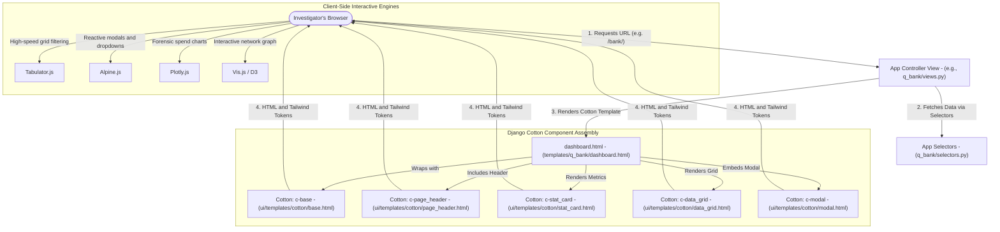
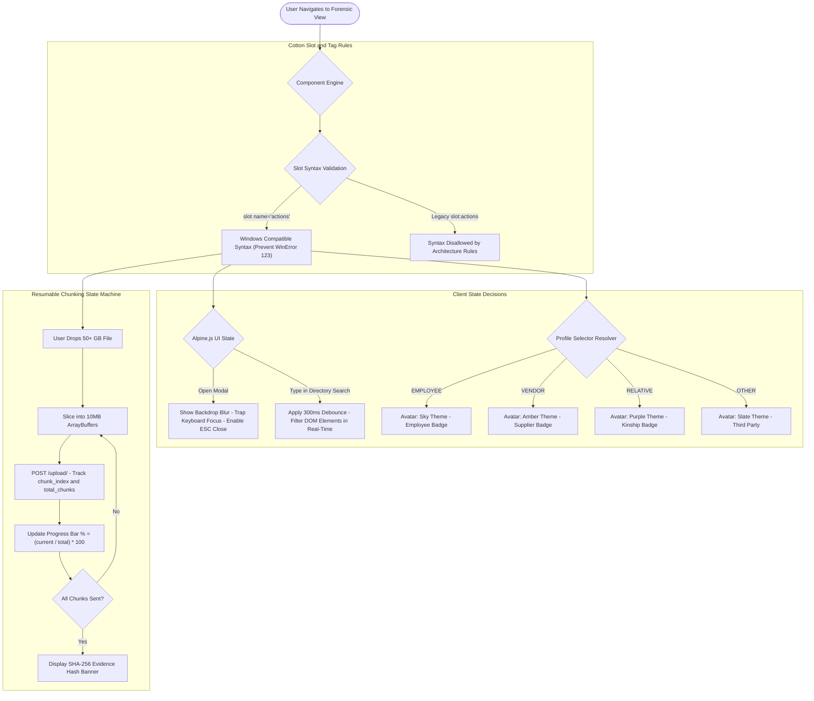

# UI App — Data & Architecture Flow

> **Audience**: Anyone seeking a clear, layman-friendly explanation of how ForensiQ's user interface, reusable components, and client-side design system work — grounded in the actual codebase.

---

## 1. The Big Picture: What is `ui`?

In a large corporate forensic platform with 9 different analytical engines, having each app look and behave differently would create chaos. Investigators would be confused by different buttons, inconsistent tables, or broken file upload bars.

**`ui` is the master design system and component factory for ForensiQ**. 
Instead of writing raw HTML, CSS, and JavaScript from scratch on every page, developers use **Django Cotton components** defined in `ui/templates/cotton/`. 

Think of Cotton components like **reusable Lego blocks**:
- Need a file upload zone with a progress bar? Drop in `<c-file_uploader />`.
- Need a high-speed data table that can filter 50,000 transactions instantly? Drop in `<c-data_grid />`.
- Need a KPI counter showing total flagged funds? Drop in `<c-stat_card />`.
- Need an auditee selector dropdown with color-coded avatar badges? Drop in `<c-profile_selector />`.

Every single screen across all 9 Q-Apps uses these exact same Lego blocks, ensuring the entire platform is fast, cohesive, responsive, and supports dark mode out of the box.

---

## 2. Architecture & File Breakdown

The `ui` codebase is structured around modern component-driven Django architecture:

```
ui/
├── apps.py                       # Django App configuration (UiConfig)
├── views.py                      # Component documentation / design system entry
├── static/ui/                    # Frontend styling & JavaScript libraries
│   ├── css/                      # Tailwind CSS build, custom utilities, theme variables
│   └── js/                       # Alpine.js, Tabulator.js, Plotly.js, Vis.js graph helpers
└── templates/cotton/             # The Reusable Component Library
    ├── base.html                 # Master portal shell: Sidebar, top navigation, active audit banner
    ├── page_header.html          # Standardized header banner with titles, action buttons, and live search
    ├── card.html                 # Container cards with header, body, and footer slots
    ├── stat_card.html            # Metric counter with icon, number, and status indicator
    ├── data_grid.html            # Tabulator.js wrapper for high-performance tabular data grids
    ├── file_uploader.html        # Resumable chunked file upload box with live progress and SHA-256
    ├── modal.html                # Pop-up dialog with backdrop blur and keyboard escape bindings
    ├── profile_selector.html     # Auditee / Target profile picker with colored badges
    ├── filter_bar.html           # Multi-criteria forensic filter bar
    ├── search_bar.html           # Live search bar with instant debounce
    ├── suggested_entities.html   # Entity recommendation widget with one-click profile linkage
    ├── tooltip_card.html         # Rich hover tooltip for transaction and node inspection
    └── trail/                    # Specialized visual components for money trail flow nodes
```

---

## 3. End-to-End Component & UI Flow

Here is how a user request turns into an interactive forensic dashboard using `ui`:



### Detailed Flow Steps:

1. **View Invocation & Context Assembly**:
   - The user opens a dashboard (e.g. `Q-Bank`).
   - The view retrieves normalized data from its `selectors.py`.
   - `core.context_processors.global_profiles_context` automatically injects the active investigation mandate (`active_audit`) and the list of investigation profiles.

2. **Cotton Component Compilation**:
   - The template engine assembles the page using `<c-component>` tags.
   - `<c-base>` establishes the layout: the dark sidebar navigation, the top bar displaying the active case reference (e.g. `2026-WB-01`), and global search.
   - Named slots (`<c-slot name="actions">`) inject app-specific buttons like `"Import Bank Statement"` or `"New Verification Case"` into standard header positions.

3. **Client-Side Reactive Engines**:
   - **Alpine.js**: Powers lightweight client-side reactivity (e.g., opening modals, dropdown selections, tabs) without needing heavy frameworks like React.
   - **Tabulator.js**: Renders interactive data tables. It handles 50,000+ rows smoothly with client-side column sorting, multi-keyword search, and instant Excel/CSV download.
   - **Plotly.js**: Renders interactive financial charts (spend distribution, debit vs credit timelines) with hover tooltips and zoom controls.
   - **Vis.js**: Renders interactive network nodes and directed edges in `q_trail` and `q_link`, allowing investigators to drag nodes around and explore relationships.

4. **Resumable Chunked Ingestion Component (`file_uploader.html`)**:
   - When the user drops a massive evidence file into `<c-file_uploader>`, client-side JavaScript slices the file into binary chunks (typically 10MB each).
   - As each chunk uploads, the progress bar updates in real time. Upon completion, the component displays the computed SHA-256 custody hash.

---

## 4. Business Logic Flow & Decision Rules

The UI layer enforces design-token consistency, client-side state transitions, and Windows-safe component compilation rules.



### Detailed Business Rules & Logic Specifications:

| Rule Name | Trigger Condition | Logic & Thresholds | Outcome / Business Action |
| :--- | :--- | :--- | :--- |
| **Windows Slot Tag Safety** | Developers define Cotton slot blocks | Must use `<c-slot name="...">`. Never use colon `<c-slot:...>`. | Prevents Windows file path exception (`WinError 123`) in template compilation. |
| **Resumable Chunk Slicing** | User attaches file in `<c-file_uploader>` | JavaScript `File.prototype.slice(start, end)` with 10MB chunk size. | Prevents browser memory overflow and web server POST payload limits. |
| **Live Directory Search Debounce** | User types in directory search bars | Debounce timer: 300 milliseconds before triggering DOM filter. | Prevents sluggish UI lag when searching lists with thousands of items. |
| **Category Avatar Color Binding** | Profile badge or selector rendered | Maps profile category to predefined palette: `EMPLOYEE` -> Sky, `VENDOR` -> Amber, `RELATIVE` -> Purple, `OTHER` -> Slate. | Provides instantaneous visual recognition of suspects across graphs, cards, and tables. |
| **Modal Focus & Escape Trap** | User opens dialog modal | Keydown event listener for `Escape` key (`@keydown.escape.window="isOpen = false"`). Traps tab focus inside modal. | Guarantees accessible, keyboard-friendly UI compliance. |
| **Tabulator Virtual DOM Threshold** | Grid rendered with > 1,000 rows | Enables Tabulator `renderVertical = "virtual"`. Only visible rows exist in browser DOM. | Renders 100,000+ financial records smoothly at 60 FPS without crashing the browser tab. |

---

## 5. Key UI Tokens & Design Standards

| Component Tag | Core Purpose | Where it is Used |
| :--- | :--- | :--- |
| `<c-base>` | Master portal shell with sidebar, top navbar, theme toggles | All 9 Q-Apps & Core |
| `<c-page_header>` | Standard page title, active case badge, live search, action buttons | Main hub dashboard of every app |
| `<c-stat_card>` | KPI counter card showing counts, currency values, and risk scores | Top of dashboards across all apps |
| `<c-data_grid>` | High-performance Tabulator table with export and live filter | All ledger, message, and transaction views |
| `<c-profile_selector>` | Auditee picker with initials and category badges | Inside all file ingestion modals |
| `<c-modal>` | Reusable modal dialog with backdrop blur | Upload and configuration forms |
| `<c-suggested_entities>` | Sidebar listing AI-discovered leads with "+ Link" button | Q-Voice, Q-Chat, Q-Scan detail views |

---

## 6. How `ui` Connects to the Rest of ForensiQ

- `ui` provides the **visual and interactive fabric** that ties `core` and the 9 specialized apps (`q_bank`, `q_mail`, `q_trail`, `q_scan`, `q_verify`, `q_link`, `q_voice`, `q_ledger`, `q_chat`) into one unified, enterprise-grade software platform.
